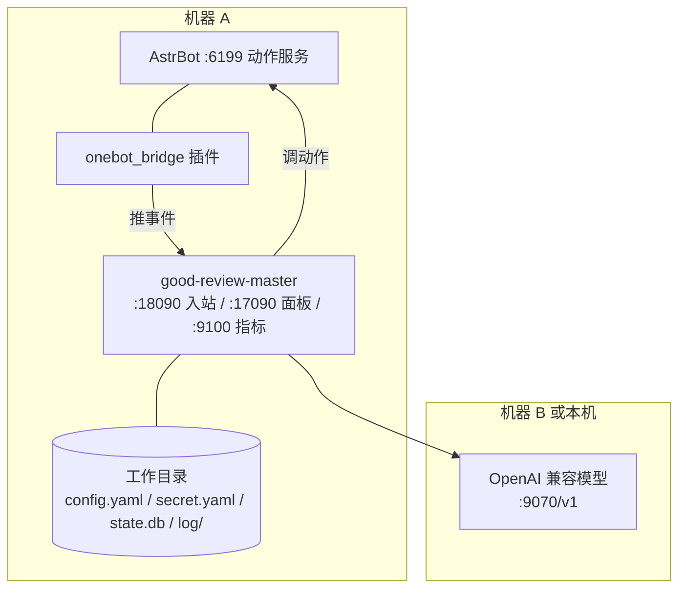

# 部署

## 形态

一台机器跑三样东西：AstrBot（带桥接插件）、本进程、模型服务（可以是本机也可以是远端）。没有容器编排，没有反向代理也能跑，全程内网通信。



## 文件放哪

所有路径都相对**进程的工作目录**（`apppath.ExeDir` 先取 cwd，取不到才退回可执行文件目录），所以启动前先 `cd` 到放配置文件的那一层。

| 路径 | 谁生成 | 说明 |
| --- | --- | --- |
| `config.yaml` | 首次运行自动生成 | 非敏感配置，可进版本库 |
| `secret.yaml` | 首次运行自动生成，权限 0600 | API Key、面板密码、IM token，禁止进版本库 |
| `state.db` + `-shm` / `-wal` | 自动建库 | 全部消息、档案、统计；WAL 模式 |
| `log/bot.log` | 运行中 | 单文件 20 MB 切割，留 30 个旧文件、最多 30 天 |
| `web/server/static/frontend/` | 构建脚本拷进来 | 内嵌进二进制的 H5 面板 |
| `sidecar/astrbot_plugin_onebot_bridge/` | 仓库自带 | 拷到 AstrBot 的插件目录 |

## 先起谁

先 AstrBot（`qq_official` 适配器和插件都起来，6199 能连），再起本进程。本进程的 IM 入口在 `runtime.im_listen_addr` 上等事件，AstrBot 推不通只会让对方报错，这边不会有提示。

启动成功后日志里能看到两行地址：`指标端点已启动 addr=http://127.0.0.1:9100/metrics` 和 `Web 管理面板已启动`。没有这两行说明对应的配置被关了或绑定失败——绑定失败只记错误，进程照常干活。

## 端口

| 端口 | 默认值 | 要不要对外 |
| --- | --- | --- |
| 18090 | `runtime.im_listen_addr` | 不用，只让 AstrBot 访问 |
| 17090 | `runtime.web_port` | 需要的话自己加反代 + TLS；关掉就填 0 |
| 9100 | `runtime.metrics_addr` | 只给 Prometheus；填 `off` 关掉 |
| 6199 | `im.api_base` 指向 | 出站，不监听 |

面板和指标刻意分成两个端口：面板要过 JWT，Prometheus 抓取带不了 token；而且面板关掉时指标依然值得看。

## 构建

两种方式，都先构建前端再编译 Go。

```bash
# 直接跑（开发）
start_main.bat     # Windows，等价于 ./start_main.sh
# 1. pnpm install --frozen-lockfile && pnpm run build:h5
# 2. 产物拷到 web/server/static/frontend/
# 3. sync_wire.bat（wire 图没变就跳过）
# 4. go run ./cmd/good-review

# 出可执行文件
build_exe.bat      # Windows，等价于 ./build_linux.sh
# 同上三步，最后交叉编译 4 个平台到 dist/
# 版本号取 git tag，无 tag 用 commit hash，有未提交改动加 -dirty
```

前端产物是嵌入的（`web/server` 的 `static` 目录），所以只拷二进制不带前端目录，面板会返回"前端资源未构建"的提示页，API 仍然可用。

## 配置从哪来

四层，后面的覆盖前面的：

1. `config.yaml` —— 业务参数，带完整注释，改之前先看那段注释，很多默认值是算过的。
2. `secret.yaml` —— 密钥。不给就用环境变量兜：`GOOD_REVIEW_LLM_API_KEY`、`GOOD_REVIEW_WEB_PASSWORD`、`GOOD_REVIEW_IM_TOKEN`。
3. 环境变量 —— 只覆盖上面三个密钥。
4. `state.db` 的 `settings` 表 —— `pipeline`、`assets` 两段的运行时覆盖，键是段名、值是同名字段 JSON。面板改参数就是写这里。

改 `config.yaml` 不用重启：`config/store` 的监听器会换快照。少数字段要重启才生效，例如 `metrics_addr`（监听地址在启动时绑定）、`web_port`。

## 关的时候

收到 SIGINT / SIGTERM 后按固定顺序退：取消 ctx（在途 LLM 调用一起取消）→ 关 Web → 关指标 → 关 IM 入口 → 等工作空间里的 goroutine 退完（异步写队列要排空，否则最后几条消息丢）→ 关库 → 关 MCP 子进程 → 冲刷 trace。整体预算 10 秒。

把面板放在 LB / K8s 后面时，配 `runtime.shutdown_delay_sec`（例如 5）：先让 `/readyz` 返回 503，等上层把流量切走，再停监听。代价是每次退出多等这么久，必须小于那 10 秒。

## 备份与重建

备份：停进程后拷 `state.db`、`-shm`、`-wal` 三个文件；或者不停进程，用 `VACUUM INTO 'backup.db'` 拿一份一致的副本。

重建：停进程，删掉三个文件，重启。建库只支持全新空库，旧结构的库会直接报错并提示删文件，不做原地升级（原因见 [ADR-0003](../adr/0003-no-migration-chain.md)）。

## 排错顺序

| 现象 | 先看 |
| --- | --- |
| 群里 @ 了没反应 | `pipeline_stage_backlog` 有没有涨；`im_events_total{result=...}` 是 accepted 还是 ignored |
| 面板打不开 | 日志有没有"Web 管理面板已启动"；`web_port` 是不是 0 |
| 面板能开但接口 401 | 登录用的是 `web_username` + secret 里的 `web_password`；JWT 过期就重新登录 |
| 指标抓不到 | 9100 是不是被占（启动日志会写"指标端点异常退出"）；`metrics_addr` 是不是 off |
| 一直没回复且日志报模型超时 | `llm.breaker_failures` 打开期间调用会被立刻拒绝；`llm_rejected_total` 分 reason 看 |
| 启动报"state.db 是旧版结构" | 删掉 `state.db` 三个文件重启 |
| 退出要等十秒 | 有在途生成没结束，或 `drain_timeout_sec`、`shutdown_delay_sec` 配得大 |
