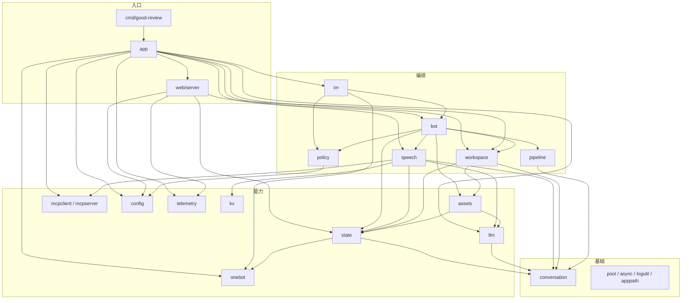

# 代码分层

## 四层

| 层 | 包 | 这一层干什么 |
| --- | --- | --- |
| 入口 | `cmd/good-review`、`app`、`web/server`、`web/frontend` | 接线、监听、把外部请求翻成调用 |
| 编排 | `im`、`bot`、`speech`、`workspace`、`pipeline`、`policy` | 一次事件怎么走完整个流程 |
| 能力 | `state`、`llm`、`onebot`、`assets`、`mcpclient`、`mcpserver`、`config`、`telemetry`、`kv` | 对着外部世界的一种能力，各自独立可换 |
| 基础 | `conversation`、`pool`、`async`、`logutil`、`apppath`、`version`、`internal/testutil` | 值对象和纯工具，不依赖业务 |

依赖只能往上走：入口可以调编排，编排可以调能力，能力可以调基础。反过来不行。

## 域之间怎么串起来

域与域之间互不调用。域执行完把结果交回编排层（`bot.Bot` 的 `orchestrator`），编排层查工作流表（`workflows`：每条工作流带入口 `entry`、去向 `next`、终点 `ends`），把消息编码成 `pipeline.Item` 投进下一个节点的 `pipeline.Buffer`，或者就地结束。

- **一次交接 = 一个 `Item`**，`Body` 是 JSON 载荷（`conversation.Inbound` / `Synced`）。域手里没有 `Buffer`，也不知道下游是谁——它只说「这一步发生了什么」（`Outcome.Signals` 里的 `Event`），不评价这件事够不够格当最后一站。
- **`Item` 里带两级身份**：`Node` 是目标节点（接 MQ 时是 topic），`Tag` 是所属工作流（接 MQ 时是 tag）。去向只在所属工作流内解析，所以两条工作流各有一个 `done` 不冲突，同一个域也能被多条工作流复用。
- **一个节点一段消费 = 一个 `pipeline.Consumer`**。节点数不是架构约束：加一个域就是 `orch.mount` 一次 + `connect` 一条。
- **一个前置 + 多条工作流**。前置（`mountRouter`）是入口 + 补全，所有消息共用、不属于任何一条工作流；工作流用 `orch.workflow(名字, 入口域)` 声明，之间互不相连。今天只有一条：聊天（补全→指令闸门→打标签→生成）。指令不再是独立工作流，但仍然是自己的节点与并发槽（`command_concurrency`），也不进群聊缓存。
- **顺序由编排层统一提供**。`Item.Key` 是分区键（`workspaceID|chatID`），同 key 串行、不同 key 并行，域自己不用加锁保序。
- **到哪结束也由编排层定**。终点写在工作流上（`orch.exit`），不写在域里：同一个域挂在两条工作流上，可以一条继续、一条到此为止，域一行不改。
- **投递失败不重试本批**。域交回回执时副作用已经发生了（入库、打标签、发出回复），重跑一遍等于重复执行；所以记一条死信让这条消息停在这一跳。

所以这个项目的骨架不是“几个固定步骤的顺序调用”，而是**一个前置 + 消息驱动的域 + 一个编排层**。今天只有一条工作流，但机制支持多条：加一条（别的入口、别的域组合）不需要新实例，也不需要动前置。见 [ADR-0005](../adr/0005-orchestration-layer.md)、[message-flow.md](message-flow.md)。

## 每个包一句话

| 包 | 职责 | 从这进 | 详情 |
| --- | --- | --- | --- |
| `cmd/good-review` | 只有一个 `main`，调 `app.New` 和 `Run` | `main.go` | 本文 |
| `app` | 组合根：构造全部对象、启动、按序关闭 | `app.go` 的 `Start` / `Shutdown` | [overview](overview.md) |
| `web/server` | Gin 路由、JWT 登录、面板 API、静态资源 | `server.go` 的 `newRouter` | [domains/panel](../domains/panel.md) |
| `web/frontend` | UniApp H5，构建产物嵌进二进制 | `package.json` | [domains/panel](../domains/panel.md) |
| `im` | 入站 HTTP：收 AstrBot 推来的事件，立刻应答 | `server.go` 的 `Start` | [domains/ingest](../domains/ingest.md) |
| `bot` | 编排层（`orchestrator`）+ 前置与三个域的具体实现 | `orchestrator.go`、`router.go`、`handler.go` 的 `NewBot`、`domains.go` | [message-flow](message-flow.md) |
| `speech` | 指令路由、生成、主动插话裁决、排版、发送 | `router.go`、`generate.go`、`dispatch.go` | [domains/speech](../domains/speech.md) |
| `workspace` | 工作空间（= 一个机器人账号）的内存态与共享库读写 | `workspace.go`、`sync.go` | [domains/workspace](../domains/workspace.md) |
| `pipeline` | 节点契约与缓冲：`Item`、`Buffer`、`Consumer` | `contracts.go`、`buffer.go`、`consumer.go` | [domains/pipeline](../domains/pipeline.md) |
| `policy` | 群白名单、开通名单、只记录不回复，纯函数 | `policy.go` | [domains/ingest](../domains/ingest.md) |
| `state` | SQLite 档案：建库、所有表的读写、缓存与统计 | `state.go`、`schema.go` | [domains/state](../domains/state.md) |
| `llm` | 模型客户端、限速、熔断、重试、结构化输出 | `llm.go`、`resilient.go` | [domains/llm](../domains/llm.md) |
| `onebot` | OneBot 12 的出站动作客户端与消息结构 | `client.go`、`message.go`、`types.go` | [reference/im-protocol](../reference/im-protocol.md) |
| `assets` | 图片描述与后台补标签 | `tagger.go`、`jobs.go` | [domains/pipeline](../domains/pipeline.md) |
| `mcpclient` | 连远端或 stdio 的 MCP 服务，聚合工具清单 | `manager.go`、`tool.go` | [domains/speech](../domains/speech.md) |
| `mcpserver` | 内嵌 MCP 服务，给模型提供"看图"这类本地工具 | `server.go`、`fetch.go` | [domains/speech](../domains/speech.md) |
| `config` | 分域加载 yaml、合成内部结构、提示词与热重载 | `loader.go`、`section_*.go`、`store/` | [deployment](deployment.md) |
| `telemetry` | Prometheus 指标、OTLP 追踪 | `metrics.go`、`trace.go` | [ops/monitoring](../ops/monitoring.md) |
| `kv` | 本地缓存（Ristretto），存会话窗口与锚点 | `kv.go`、`ristretto.go` | [domains/llm](../domains/llm.md) |
| `conversation` | 会话值对象与节点载荷：`Inbound`、`Synced`、`Message` | `types.go`、`cache.go` | [domains/pipeline](../domains/pipeline.md) |
| `pool` / `async` | 有界协程池 + 带 recover 的提交封装 | `pool.go`、`async.go` | 本文 |
| `logutil` | zap + lumberjack，控制台和文件双写 | `logger.go` | [deployment](deployment.md) |
| `apppath` | 取工作目录，拼配置文件路径 | `apppath.go` | [deployment](deployment.md) |
| `version` | 版本号，构建脚本注入 | `version.go` | 本文 |
| `internal/testutil` | 假 LLM，测试用 | `fake_llm.go` | [ops/testing](../ops/testing.md) |

## 四条不许破的依赖规则

1. **除 `main` 外没人 import `app`**。组件需要别的组件时由 `app` 注入。见 `app/app.go` 的包注释。
2. **`pipeline` 不定义载荷**。`Inbound`、`Synced` 在 `conversation` 里，否则 `workspace`、`assets` 为了用值对象反过来 import 编排层。
3. **`conversation` 里只放能序列化的值**，不放 `*Workspace` 这类运行时指针。这是"以后换 MQ 不改业务代码"的前提。
4. **`policy` 只 import `config`**，且只有纯函数。同一条白名单规则只在这里实现一份，`config` 和 `workspace` 不再各写一遍。
