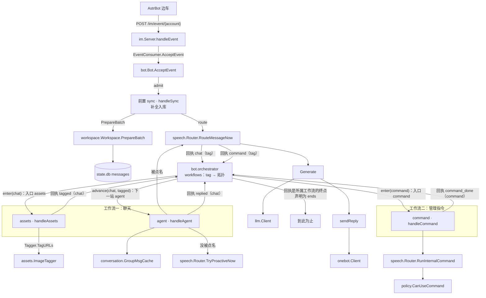

# 一条消息的全链路

这篇按「消息此刻在谁手里」的顺序走一遍。每一步只回答三件事：**谁接手、手里拿着什么值、靠哪些结构把活干完**，以及接着交给谁。读完应该能做到：任意一个环节出问题，直接定位到包和类型，不用翻全仓。

只写现状，不写为什么这么设计。设计取舍看 [domains/pipeline.md](../domains/pipeline.md)、[domains/speech.md](../domains/speech.md)、[domains/ingest.md](../domains/ingest.md)。

## 全程一张图



一句话版：`im.Server` 收 → `bot.Bot` 交给编排层的前置 → 前置的 `sync` 补全入库、`router` 回一句「这条走聊天还是走指令」→ 编排层把这个名字记成消息的 **tag**，按它找到那条工作流的入口域（**topic**）：聊天走 `assets` 打标签 → `agent` 生成；指令走 `command` 执行。`agent` 之后的 `speech` 决定回不回、回什么，`deliver` 发出去。两条工作流的最后一个域交回「这一步完成了」，各自那条工作流把它声明为终点，消息到此结束。

**前置只有一道，工作流有多条**。前置管「入口 + 补名 + 走哪条」，两条工作流之间没有任何连线——加一条工作流只是多一个 `workflow` 声明和它的几条 `connect`，前置不用动。

**域与域之间不互相调用**，中间那一跳永远是编排层：域手里没有 `Buffer`，只把「这一步发生了什么」交回去。

**一条工作流到哪结束，也是编排层说了算**。域只汇报事实，不汇报「我是不是最后一站」——同一个域挂在另一条工作流上，可以在那里继续往下走，域一行不用改。

## ① 入站：`im.Server.handleEvent`

**手里**：HTTP 请求体（OneBot 12 事件 JSON）。

**它只做校验和翻译，不做业务**。做完就把事件交出去，HTTP 立刻返回。

| 结构 | 位置 | 干什么 |
| --- | --- | --- |
| `Server` | `im/server.go` | 路由、`Authorization` 常数时间比对、1 MB 体积上限、`X-OneBot-Version` 检查 |
| `onebot.Event` | `onebot/types.go` | 事件解码后的唯一形态；`Event.ChatID()` 决定群聊/私聊的会话键 |
| `EventConsumer` | `im/server.go` | 只有 `AcceptEvent(ctx, account, event)` 一个方法的接口，由 `*bot.Bot` 实现 |

用接口而不是直接 import `bot`：`im` 只认识「有人能接事件」，不认识流水线。

**交给**：`bot.Bot.AcceptEvent`。

## ② 排队：`bot.Bot.AcceptEvent`

**手里**：`onebot.Event` + URL 里的账号。

这一步回答「这条消息属于哪个机器人账号」「是不是重复的」「排队排得下吗」。

| 结构 | 位置 | 干什么 |
| --- | --- | --- |
| `workspace.Manager.ResolveOrCreate` | `workspace/workspace.go` | `(platform, account_kind, account)` → `*Workspace`；不在开通名单就返 nil，事件被丢弃 |
| `conversation.ChatKey` | `conversation/types.go` | `workspaceID + "\|" + chatID`，后面所有分片、缓存、落库都用它当键 |
| `messageDedup` | `bot/handler.go` | TTL 10 分钟的内存短表，兜住「前置的缓存还看不到这条消息」这段窗口；入队失败会 `forget` 撤占位 |
| `pipeline.Item` | `pipeline/buffer.go` | 节点之间**唯一**搬运的东西：`ID`（`node\|tag\|key\|消息ID`）、`Key`、`Node`（topic）、`Tag`（工作流）、`Body`（JSON）、`Attempts` |
| `pipeline.MemoryBuffer` | `pipeline/buffer.go` | 每分区一条 FIFO + 全局限量；满了阻塞不丢 |
| `conversation.Inbound` | `conversation/types.go` | `Body` 里装的值：`{WorkspaceID, Event}` |

`Item.ID` 里的消息 ID 让它天然是幂等键，将来换 MQ 不用另造。

**交给**：`orch.admit(ctx, key, msgID, Inbound{...})`——放进**前置**（`sync`），再 `Submit` 唤醒它。前置补名之后回一句「走哪条工作流」，编排层据此找到那条工作流的入口域。

第二个来源（面板、定时任务、Webhook）已经在别处补全过了，可以绕过前置、直接 `orch.start(ctx, 工作流名, key, msgID, 载荷)`。

## ③ 节点调度：`pipeline.Consumer`

前置与三个域各一个 Buffer，跑的是同一套代码（`pipeline/consumer.go`），差别只在 handler 和配置。

| 结构 | 干什么 |
| --- | --- |
| `Consumer` | 固定协程池 + 每会话串行。协程不绑定会话，从就绪队列挑一个 `key` 取一批处理 |
| `ready` / `readySet` | 就绪队列与去重索引，队首是最久没被处理的会话 |
| `inflight` | 同一 `key` 同一时刻只允许一个协程持有——「同一个群按到达顺序」就是这么保证的 |
| `maxBurstPerTurn` | 一个协程一次最多连吃 3 批同一会话，防止活跃群占死池子 |
| `ConsumerOptions.Handler` | `func(ctx, key, []Item) []FailedItem`，即 `pipeline.BatchHandler`。域和前置各被 `domainBatch` / `routerBatch` 包了一层：前者按 tag 分组后交给域，后者把前置交回的 `Pick` 投给对应工作流的入口 |
| `Item.Attempts` | 失败重试计数，超限交给 `OnDeadLetter` |

前置、域、缓冲、连线、终点、工作流都在 `bot.NewBot` 里一次装完：`orch.mountRouter(名字, handler, 配置)` 挂前置，`orch.mount(名字, handler, 配置)` 挂一个域，`orch.workflow(工作流名, 入口域)` 声明一条工作流，`orch.connect(工作流名, event, 名字)` 说清「这条工作流里这类事件由谁接手」，`orch.exit(工作流名, event)` 说清「这条工作流里这类事件到此为止」。域自己不知道下游是谁，也不知道自己是不是最后一站。

两条投递路径对应两种回执：前置交回 `Pick`（这条消息进哪条工作流），域交回 `Signal`（这一步发生了什么）。`routerBatch` 收 `Pick`：`enter(pick.Workflow)` 换成入口域，同时把工作流名写成下一跳的 `Tag`；`dispatch` 收 `Signal`：先问 `isEnd`（这条工作流声明过终点就到此为止），再由 `advance` 在**消息自带 tag** 的那条工作流的 `next` 里查去向。查不到是装配错误，打 Error 丢弃。

这就是 RocketMQ 的 **topic + tag**：`Item.Node` 是 topic（谁消费），`Item.Tag` 是 tag（属于哪条工作流）。tag 只在所属工作流内唯一，所以两条工作流可以各有一个 `done`，同一个域也可以被两条工作流复用。

## ④ 前置：`sync` 补全 + `router` 择路

**手里**：一批 `conversation.Inbound`（同一会话）。

前置里是**两个东西**，不是一个：

| | 做什么 | 会不会失败 | 代码 |
| --- | --- | --- | --- |
| `sync`（`handleSync`） | 补名、补引用、同步写 `messages` | 会：库写不进要重试 | `bot/domains.go` |
| `router`（`route`） | 读配置与内存态，回一个工作流名 | 不会：查不到就是聊天 | `bot/router.go` |

两段在同一个循环里跑，中间不多一次编码：

```go
for _, synced := range ws.PrepareBatch(ctx, inbounds) {
	out.Picks = append(out.Picks, b.route(ws, cfg, synced))   // 补全 → 择路
}
```

**为什么 router 不是一个节点**（没有自己的 Buffer）。三条，判据都是「它有没有独立的资源特征」：

- 择路只是一次配置读取加一次前缀树匹配。补全要写库、打标签要调视觉模型、生成要调大模型——那些才值得一个池子。
- 它和补全共享同一个内存值（`synced.Message.Content`）。拆成两个节点就要把整个 `Synced` 编码成 JSON 再解出来，只为读一个字段。
- 它没有失败模式。没有失败就没有重试、没有死信、没有队列。

等择路本身变贵了（查库按租户取规则、走规则引擎、调模型判断意图），它才需要独立成节点。详见 [bot/router.go 的文件头](../../bot/router.go)。

两段都不属于任何一条工作流：加一条工作流，这两处都不用动。

`PrepareBatch`（`workspace/sync.go`）是「补全」的全部内容：

| 结构 | 干什么 |
| --- | --- |
| `policy.AllowsStream` | 群白名单。不在名单的群，消息在这里就被跳过（不入库、不回复） |
| `GroupMsgCache.HasSeen` | 按 `(self_id, message_id)` 去重，防止同群多账号重复记一遍 |
| `directory` | 群与成员档案：`EnsureGroupFrom` 建档、`ObserveMemberFrom` 记「这人在这群出现过」 |
| `ResolveNames` | 每会话一次批量补名：先查内存缓存，miss 落 `members` 表 |
| `Event.RenderText` | 把 `@` 段渲染成 `@昵称(openid)`，按 `max_msg_rune` 截断，得到真正入库的正文 |
| `Event.QuotedMessageID` / `ResolveMessageID` | 补引用关系，`RefIdx` 用于反查平台侧被引消息 |
| `conversation.Message` | 补全的产物：正文、昵称、`Mentions`、`Images`、`ReplyToID`、`Time` |
| `state.Scope.SaveMessage` | **同步**写 `messages`，返回自增主键 `RowID`。发给大模型的 `message_id` 就用它，窗口重置也不重编号 |
| `conversation.Synced` | 送进下一段的值：`{WorkspaceID, ChatID, Private, Event, Message}` |

补名收尾会调 `scheduleMentionBackfill`：成员名是异步回来的，早先写库的 `@用户(id)` 需要回填。

**路由规则**（`workflowOf`：只读、无副作用，可以单独测）：

```go
if isInternalCommand(...) && !policy.IsRecordOnly(...) → WorkflowCommand
else                                                     → WorkflowChat
```

- `isInternalCommand` 调 `Router.MatchInternalCommand`：**只读**匹配（点名判定 → 剥前缀 → 前缀树 → `Category == "internal"`），不执行任何东西。
- `record_only_accounts` 的账号不转出：它的指令按普通消息继续走聊天工作流，由生成域回固定话术。
- 工作流名到入口域的那张表在 `bot/handler.go`：`chat → assets`、`command → command`。

## ⑤ 控制域：`bot.handleCommand`

**手里**：`conversation.Synced`。

只转发一次调用，其余全在 `speech` 里：

| 结构 | 位置 | 干什么 |
| --- | --- | --- |
| `Router.RunInternalCommand` | `speech/command_run.go` | 指令**唯一**的副作用入口：再匹配一次 → 判权限 → 取参数 → 调 handler |
| `routeTable` / `trieNode` | `speech/command.go` | 前缀树快照，`atomic.Pointer` 整体替换；`trieMatch` 是最长前缀匹配 |
| `Command` | `speech/command.go` | 一条指令：关键字、`Category`、`Handler`、可选人格 |
| `commandText` | `speech/command_run.go` | 按**文本段**取正文（不用渲染后的正文），尾部 `@机器人` 不会污染参数 |
| `policy.CanUseCommand` | `policy/policy.go` | 权限唯一实现：私聊放行、群内按 `bot.command_admins` 精确匹配、`#帮助` 例外 |
| `internal_cmd.go` 各 handler | `speech/internal_cmd.go` | 真正干活：切人格写 `groupPersona` + `personaStore`，增删指令触发 `Rebuild` |

两次匹配（前置路由一次、执行前一次）是故意的：中间可能被别的指令改了路由表（`#删除人格` 会删关键字），第二次失配就丢弃——正文在前置已经入库了。

这个域 `Retries` 固定 0：指令副作用不幂等，重试一次就是执行两次。

处理完交回一条 `EventCommandDone` 回执。域只汇报「这一条经手完了」；指令工作流在 `NewBot` 里把 `command_done` 声明为终点（`orch.exit`），所以消息到此结束。**终止由链声明，不由域沉默**——要让指令执行完接下一个域，把那条 `exit` 换成 `connect` 就行，这个文件不用改。

## ⑥ 打标签域：`bot.handleAssets`

**手里**：`conversation.Synced`。

只处理图片，且只处理「库里还没有描述」的图。

| 结构 | 位置 | 干什么 |
| --- | --- | --- |
| `assets.ImageTagger.TagURLs` | `assets/tagger.go` | 按 `ImageIDs`（sha256+大小）查 `image_notes`，缺的才调视觉模型；并发受 `tag_concurrency` 限制 |
| `assets.TagResult` | `assets/tagger.go` | 四个产物：`ImageIDs`、`ImageNotes`（与 `Images` 对齐）、`Assets`、`Status`，外加 `Deferred`（没打完的） |
| `state.UpdateMessageImages` | `state/messages.go` | 把图片标识回写到已经入库的那一行 |
| `state.AssetTagJob` | `state/jobs.go` | 欠条：只记原始 URL，由后台 `assets.Backfiller` 补，不阻塞消息 |
| `conversation.Asset` / `Status*` | `conversation/asset.go` | 给生成域和模型看的标签结论（含降级提示） |

打完把每条消息以 `EventTagged` 回执给编排层，`Message` 被就地改写（多了 `ImageIDs` / `ImageNotes`），其余字段原样带下去。

## ⑦ 生成域：`bot.handleAgent`

**手里**：`conversation.Synced`。

这一段决定「要不要回」，并且把消息送进群聊缓存——缓存是后面所有选窗、裁定的数据源。

每条经手的消息都交回一条 `EventReplied` 回执，包括判定「不该回」的那些。`replied` 在聊天工作流上被声明为终点。

| 结构 | 位置 | 干什么 |
| --- | --- | --- |
| `conversation.Store` / `GroupMsgCache` | `conversation/cache.go` | 每群一个环形缓存 + O(1) 去重集；`Add` 入缓存，`GetAll` 出快照 |
| `Workspace.LearnIdentity` / `SyncSelfName` | `workspace/workspace.go` | 学机器人自己的 openid 与群内显示名（openid 是账号级，学一次全群可用） |
| `policy.IsRecordOnly` | `policy/policy.go` | 只记录不回复的账号：缓存入库照做，被点名时 `SayFixed(RecordOnlyReply)` 就结束，不调模型 |
| `conversation.FindMsgIndex` | `conversation/cache.go` | 在快照里定位触发消息；找不到说明已被挤出窗口 → 记 `window_too_small` 告警并放弃 |
| `speech.IsAddressed` | `speech/judge.go` | 这条是不是冲机器人来的（@、昵称、私聊） |
| `Router.RouteMessageNow` | `speech/dispatch.go` | 被点名：同步跑完路由 → 生成 → 发送 |
| `Router.TryProactiveNow` | `speech/proactive.go` | 没被点名：交主动插话，三重限流 + latest-wins |

两个容易看漏的取舍：快照是 `msgs[:index+1]`（触发消息之后的不要）；主动插话一批只看最后一条，且生成域自己队列里还有积压时干脆不判（`orch.backlog`）。

## ⑧ 发话：`speech.Router.routeMessage`

**手里**：正文 + `onebot.Event` + `groupID` + 冻结的窗口快照。

| 结构 | 位置 | 干什么 |
| --- | --- | --- |
| `appCfg()` 快照 | `speech/router.go` | 开头取一次全程共用，避免「新模型名 + 旧昵称」这种混合提示词 |
| `stripCQPrefix` | `speech/dispatch.go` | 剥掉开头的 `@机器人` / 昵称前缀 |
| `trieMatch` | `speech/command.go` | 命中关键字就拿到 `*Command` |
| `ComposeSystemPrompt` | `speech/prompt.go` | 机器人身份 + 人格块 + 回复要求 + 焦点提示，拼成 system prompt |
| `groupPersona` | `speech/router.go` | 本群当前人格（`#切换人格` 维护），只在「未命中关键字的纯 @」时追加 |
| `HandlerFunc` | `speech/command.go` | 功能指令如 `chat_review` 的处理器；`Handler` 为 nil 或未命中时走 `replyDefaultNow` |

三条岔路：

| 命中什么 | 走哪 | 结果 |
| --- | --- | --- |
| `Category == "internal"` | `RunInternalCommand` | 正常链路已经到不了这里（控制域拦了），只剩面板/调试触发 |
| 功能指令（如「锐评」） | `route.Handler` | 先记「触发锐评」日志，再进 `Generate` |
| 没命中 | `replyDefaultNow` | 纯问答，按群人格补 system prompt |

## ⑨ 生成：`Generate` → `runReviewLLM` → `mcp_loop`

**手里**：`replyParams`（事件、systemPrompt、`keywordPrompt`、`snapshot`/`window`、`images`、已拿到的裁决）。

| 结构 | 位置 | 干什么 |
| --- | --- | --- |
| `cutAtMessage` | `speech/generate.go` | 只保留触发消息之前的部分，@ 之后新到的消息不算进这次请求 |
| `LLMAnchor` | `conversation/cache.go` | 上次发送窗口的首尾 + 时间；过了 `cache_ttl` 就当没有，免得按失效前缀算假账 |
| `decideChatWindow` | `speech/chat_window.go` | 纯函数：扩展命中前缀 vs 重置窗口，按 `cache_hit_cost` / `cache_miss_cost` 比成本，带上 `max_context_tokens` 护栏 |
| `BuildChatLog` / `BuildUserMsg` | `conversation/cache.go` / `speech/generate.go` | 窗口 → 聊天记录文本 → user 消息（含 image 候选块） |
| `llm.Client` | `llm/llm.go` | `Chat` 请求：`[]llm.Message` + `[]llm.Tool`；限速、熔断、重试在 `llm/resilient.go` |
| `mcpserver` / `mcpclient` | `mcpserver/`、`mcpclient/` | 工具清单与执行；`runReviewLLM` 看有没有工具决定单轮还是工具轮 |
| `Reply` | `speech/deliver.go` | 生成产物：`Sentences`、`Event`、`ChatID`、`Mention`、`Anchor`。只装值，编码即走 |

工具轮的收口在 `mcp_loop.go`：执行调用 → 截断结果（`max_tool_result_rune`）→ 回填 → 再问一轮，最多 `max_tool_rounds`。

## ⑩ 交付：`sendReply`

**手里**：`Reply`。

| 结构 | 位置 | 干什么 |
| --- | --- | --- |
| `rewriteReply` | `speech/reply_format.go` | 用 JSON schema 强制拆成最多 `reply_max_sentences` 句短句；`longForm` 跳过，排版失败退回原文 |
| `buildReplyActions` | `speech/deliver.go` | 句子 → 发送动作，每条动作一个稳定 `action.ID` |
| `SendLedger` | `speech/deliver.go` | 动作编号 → 是否已发；重试时跳过已发动作，不重复刷屏 |
| `onebot.Client` | `onebot/client.go` | `send_message` 等动作打到 AstrBot（`:6199`），按 `reply_send_interval_ms` 分条 |
| `recordSelfReply` | `speech/deliver.go` | 机器人自己的回复也入库、也进缓存，下一轮才有上下文 |
| `SetLLMAnchor` | `conversation/cache.go` | 整次发送完成才推进锚点；没发出的句子不会因为锚点前移被跳过 |

`Sink` 现在只有 `SinkChat` 一个实现；`SinkPanel` / `SinkAgent` 会明确报「尚未实现」，不静默丢。

## 同一条消息变了七次形状

| 在哪一步 | 类型 | 谁填 | 关键字段 |
| --- | --- | --- | --- |
| 入站 | `onebot.Event` | `im.Server` | `Self`、`Message`、`GroupID`/`UserID`、`MessageID` |
| 排队 | `conversation.Inbound` | `bot.AcceptEvent` | `WorkspaceID`、`Event` |
| 补全 | `conversation.Synced` + `Message` | `PrepareBatch` | `ChatID`、`Private`、`Message.RowID`、`Mentions`、`Images` |
| 打标签 | 同上（`Message.ImageIDs/ImageNotes` + `Assets`/`AssetStatus`） | `handleAssets` | 图片描述与降级状态 |
| 进模型 | `[]llm.Message` | `Generate` | role/content，`RowID` 作为 `message_id` |
| 出模型 | `speech.Reply` | `Generate` | `Sentences`、`Anchor`、`Mention` |
| 出站 | `onebot` 动作 JSON | `sendReply` | `message` 段、`reply`/`mention` 目标 |

中间那一层 `pipeline.Item` 是不变的外壳，载荷全是 JSON——这是「以后换 MQ 不改业务代码」的支点。

## 改动落点速查

| 我想改 | 动这里 |
| --- | --- |
| 收事件的方式、鉴权、体积 | `im/server.go` |
| 哪个账号/群接管 | `policy.AllowsStream`、`workspace.Manager.ResolveOrCreate` |
| 消息怎么补全、怎么入库 | `workspace/sync.go` 的 `PrepareBatch` |
| 域之间谁接谁、加一个域 | `bot/handler.go` 的 `mount` / `connect`，以及各域的 `Outcome.Signals` |
| 加一条工作流（新的入口 + 新的域组合） | `bot/handler.go` 的 `workflow` / `connect`；前置不用动 |
| 某一类消息到此为止、或接下一个域 | `bot/handler.go` 的 `exit` ↔ `connect`，域不用改 |
| 什么算管理指令、走哪条工作流 | `bot/router.go`（`route` / `workflowOf`） |
| 指令的权限与执行 | `speech/command_run.go` + `policy.CanUseCommand` |
| 指令本身的行为 | `speech/internal_cmd.go` 对应 handler |
| 打标签、看图 | `assets/tagger.go`、`asset_tag_jobs` 的后台补 |
| 什么时候回复、回什么 | `speech/dispatch.go`、`generate.go`、`judge.go` |
| 怎么发、发几条 | `speech/reply_format.go`、`deliver.go` |

## 相关

- 为什么各域不互相调用、而是由编排层用消息串起来：[ADR-0005](../adr/0005-orchestration-layer.md)
- 节点参数、缓冲语义、关停顺序：[domains/pipeline.md](../domains/pipeline.md)
- 选窗、判词、主动插话、工具轮：[domains/speech.md](../domains/speech.md)
- 入站协议与去重：[domains/ingest.md](../domains/ingest.md)、[reference/im-protocol.md](../reference/im-protocol.md)
- 表结构与读写：[domains/state.md](../domains/state.md)
