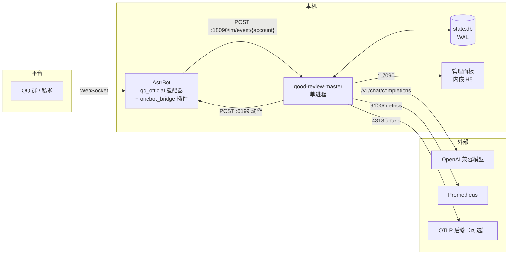
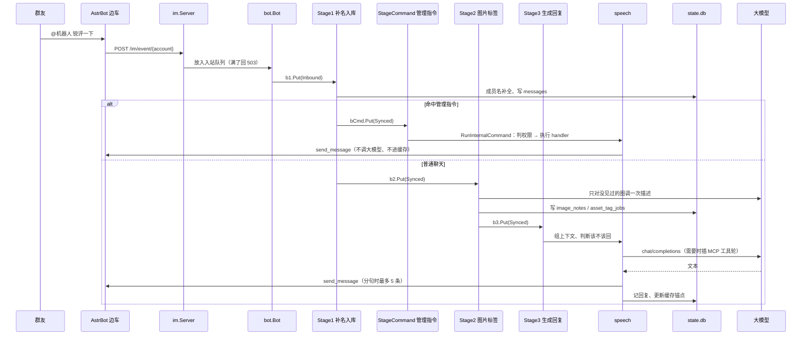

# 全局视角

## 这是什么

一个单进程的 QQ 群聊机器人：收到群消息后拼上下文、调大模型、把回复发回群里，同时把所有消息和统计落到本地 SQLite。除了一条 AstrBot 边车和一个外部模型服务，其余全在这一个进程里。

## 上下文

AstrBot 只做平台适配，不做业务：它把平台消息转成 OneBot 12 事件推给 Go，再把 Go 的 `send_message`、`get_self_info`、`get_group_member_info` 等动作翻译回平台。所以换平台（QQ 官方 / NapCat / 别的实现）只动 AstrBot 那边，Go 侧不用改。协议细节见 [reference/im-protocol.md](../reference/im-protocol.md)。

## 进程内有什么

`app.App` 是全部运行时对象的聚合体，字段在 `New` 里一次装完，之后只读。装配图由 wire 生成（`app/wire.go` → `app/wire_gen.go`），改构造关系改 `providers.go` 再跑 `sync_wire.bat`。

| 字段 | 类型 | 什么时候是 nil |
| --- | --- | --- |
| `Config` | `config.Snapshot` | 不会；每次用时调一次，别缓存返回值 |
| `Prompt` | `*config.PromptConfig` | 不会 |
| `LLM` | `llm.Client` | 不会；测试模式下是假实现 |
| `OneBot` | `*onebot.Client` | 不会 |
| `MCP` | `*mcpclient.Manager` | 不会；没配服务时是空管理器 |
| `BuiltinMCP` | `*mcpserver.Server` | `llm.image_max<=0` 或启动失败 |
| `Workspaces` | `*workspace.Manager` | 不会；一个工作空间都没有时也在 |
| `Router` | `*speech.Router` | 不会；默认工作空间那一份，给 debug 用 |
| `Bot` | `*bot.Bot` | 不会 |
| `IM` | `*im.Server` | 不会 |
| `Web` | `*webserver.Server` | `web_port<=0` |
| `Metrics` | `*telemetry.MetricsServer` | `metrics_addr=off` |

启动顺序（`App.Start`）：消费循环 → IM 入口 → 配置监听 → 提示词监听 → 指标端点 → Web 面板。前两个是核心，后四个挂了只记日志，不拦启动。

## 一条 @ 消息走完的路

这是鸟瞰图。想跟着代码走一遍（每段进哪个类型、那个类型靠什么结构干活），看
[message-flow.md](message-flow.md)；每个阶段的具体行为见 [domains/pipeline.md](../domains/pipeline.md)。

## 端口

| 端口 | 谁在听 | 用途 |
| --- | --- | --- |
| 18090 | Go（`runtime.im_listen_addr`） | AstrBot 推事件进来 |
| 17090 | Go（`runtime.web_port`） | 管理面板 API + 内嵌前端 |
| 9100 | Go（`runtime.metrics_addr`） | Prometheus 抓取，只绑本机 |
| 6199 | AstrBot 插件 | Go 调动作出去 |
| 9070 | 模型服务（示例值） | OpenAI 兼容接口 |
| 4318 | OTLP 后端（可选） | 链路追踪 |

## 几条不会变的前提

1. **依赖只在 `app` 里接线**。除 `main` 外没人 import `app`；组件要别的组件，由 `app` 注入，不许互相 import 更不许读包级全局。
2. **阶段之间只传能 JSON 序列化的 ID 和值**，不传 `*Workspace` 这类指针。这样现在是进程内缓冲，以后换 MQ 业务代码不用改。
3. **state.db 只开一个写连接**。并发调高只是排队，`sync_concurrency` 再大也不会真并行写。
4. **配置用快照**。`Config` 拿到的是某一刻的值，改了文件由监听器换快照，不原地改结构体。
5. **附加能力不拦主流程**。指标绑不上、MCP 连不上、面板关掉，回复照常。
6. **关闭有固定顺序**：取消 ctx → Web → 指标 → IM 入口 → 等工作空间里的 goroutine 退完 → 关库 → 关 MCP → 冲刷 trace。

## 读代码从哪进

`cmd/good-review/main.go` → `app/build.go` → `app/app.go`。看懂 `Start` 和 `Shutdown` 这两个方法，进程的生命周期就清楚了。再看 `bot/ingest.go` 的消费循环 `Run` 和 `pipeline/buffer.go` 的 `Buffer` 接口，就能顺着消息走到任意一个域。
