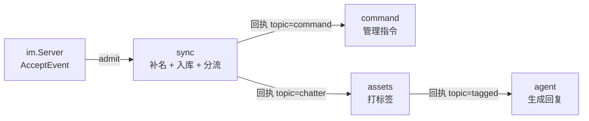

# 2026-11 编排层改造：域回消息，编排层转发

> 状态：Implemented
> 日期：2026-11
> 结论落在：[ADR-0005](../adr/0005-orchestration-layer.md)、[message-flow](../architecture/message-flow.md)、[domains/pipeline](../domains/pipeline.md)

本文的图与契约已并进上面两处；留在设计文档里的价值是「与现状的差异」和「边界条件」两节——那五条边界是逐条试出来的。

> 后续演变：本文落地后，结构又理了一道——**入口与补名（`sync`）抽成工作流之外的前置**（`mountRouter`），
> 业务拆成两条互不相连的工作流（`workflow` 声明），前置回执直接用工作流名
> （`WorkflowChat` / `WorkflowCommand`）而不是 `TopicChatter` / `TopicCommand`。
> 正文里的 `handleSync` / `topicOf` / `TopicChatter` 是当时的名字，现状看
> [message-flow](../architecture/message-flow.md) 与 [domains/pipeline](../domains/pipeline.md)。

一次改造方案，不是决策记录。要回答的是：怎么让「域」和「顺序」真正分开，以及这样做的边界在哪。

## 一句话

域执行完不自己找下游，而是把结果交回编排层；编排层按一张连线表决定下一个域是谁。这就是「编排层发消息 → 域执行 → 域回消息 → 编排层再发给下一个域」的闭环。

## 为什么现在做

- **ADR-0005 已经这么写了，代码没做到**。[ADR-0005](../adr/0005-orchestration-layer.md) 说「域不知道上游是谁，也不知道下游是谁」，但 `bot/stages.go` 里三处 `b.forward(ctx, b.b2, pipeline.StageAssets, …)` 把下游名字写死在域里。顺序长在代码里，换不了。
- **加一个域现在要动八处**：`pipeline` 的常量、`config` 的四个字段与 section 解析、`bot/handler.go` 的字段与构造函数、`bot/stages.go`、`bot/ingest.go` 里六处枚举、以及测试。
- **失败语义已经不一致**：`handleSync` 转发失败只记一条死信；`handleAssets` 转发失败会返回 `FailedItem` 让整批重试——**重试会把 tagger 再调一遍**，白花钱。这是现有代码里的真问题，不是改造带出来的。
- **`Item.Stage` 的语义是歪的**：`AcceptEvent` 造出来的 item 记的是 `ingest`，消费它的却是 `sync` 阶段；而告警分类 `dead_letter_<stage>` 和幂等键都按这个字段算。

两件**不是**理由的事，先说清楚：不是为了上 MQ（见 [mq-readiness-2026-11.md](mq-readiness-2026-11.md)），也不是为了热部署（拓扑热替换是以后的畅想，本期只做到「拓扑是一张表」）。

## 目标形态



三条不变量，改造后要能靠读代码验证：

1. **域不持有缓冲**。域的函数签名里拿不到 `Buffer`，也就无从投递。
2. **域只说「哪一类」，编排层说「谁接手」**。域返回的是 `Topic`，不是节点名。
3. **一条消息同一时刻只在一个域里**。投递与唤醒是同一步，不存在「已经算出路由但还没投出去」的中间态。

## 契约（目标形状）

```go
// 域回给编排层的回执：只说下一跳属于哪一类。
type Route struct {
    Topic   string // "chatter" / "command" / "tagged"
    Key     string // workspaceID|chatID，顺序键
    MsgID   string // 幂等键的后半段
    Payload any    // 可序列化值对象
}

// 一批消息的处理结果：哪些要重试，哪些要交回编排层继续转发。
type Outcome struct {
    Failed []pipeline.FailedItem
    Routes []Route
}

// 域。不引用下游，不碰缓冲。
type DomainHandler func(ctx context.Context, key string, items []pipeline.Item) Outcome
```

编排层自己持有两样东西：

```go
nodes map[string]*node   // 域名 → {buffer, stage}
edges map[string]string  // topic → 域名
entry string             // 入口节点
```

`pipeline.Stage` 完全不动。域交回 `Outcome` 之后由编排层投递这件事，发生在 `Stage` 和域之间的一层薄包装里：

```
Stage.process → 包装函数: out := handler(...); orchestrator.emit(out.Routes); return out.Failed
```

所以 `pipeline` 包依然不知道这个项目有几个域，也依然只管「怎么把载荷搬过去」。

## 与现状的差异

| 现在 | 改后 |
| --- | --- |
| `Bot` 持有 `b1`/`b2`/`b3`/`bCmd` 和 `stage1`…`stageCommand` 八个字段 | 只持有一个 `orch`，节点在 `orch.nodes` 里 |
| 域末尾 `b.forward(ctx, b.b2, …)` + `b.stage2.Submit(key)` | 域末尾 `return Outcome{Routes: []Route{{Topic: TopicChatter, …}}}` |
| 分流规则写在 `handleSync` 的 `if` 里 | 抽成 `topicOf(ws, cfg, synced) string`，纯读、可单测；`handleSync` 只 append |
| `Run`/`Close`/`Wait`/`drain`/`pending` 里逐字段枚举 | 遍历 `orch.nodes` |
| 入口的 `Item.Stage` 记 `ingest`，消费方是 `sync` | 入口直接记入口节点名，`pipeline.StageIngest` 退役 |
| 转发失败：`sync` 记死信、`assets` 重试整批 | 统一：**投递失败只记死信，不重试本批** |

## 边界条件（必须定死的五条）

1. **回执投递失败不重试本批。** 域返回 `Route` 时它的副作用已经发生了（入库、打标签、发出回复），重跑一遍等于重复执行。投递失败记死信，让这条消息停在这一跳。
2. **关停期投递失败不报警。** 缓冲已关（`pipeline.ErrClosed`）是预期内的排空结果，只记日志。否则正常重启会刷出一堆假死信。
3. **没连线的 topic 是错误，不是静默丢弃。** 丢弃的同时打 Error 日志——漏连线是装配错误，不是运行期正常分支。
4. **连线指向未挂载的域，构造期 panic。** 装配错误要在启动时炸，不要等某条消息走到那里。
5. **`backlog` 只许查自己的。** `handleAgent` 里判断「这一批后面还有没有积压」用的 `b.b3.Len(key)` 改成 `orch.backlog(自己的节点, key)`，域不许摸别人的队列。

## 明确不做

| 不做 | 原因 |
| --- | --- |
| 拓扑热替换 | 本期只要「拓扑是一张表」；drain-swap、版本号、在途清零都是另一件事 |
| 动态加载域实现 | Go 做不到（plugin 在 Windows 上基本不可用，且不能卸载） |
| 把 `Ack` 用起来 | 只有接 MQ 才有意义，内存实现的 `Take` 即出队 |
| 落盘（outbox） | 见 [mq-readiness-2026-11.md](mq-readiness-2026-11.md) 的「本期结论：不做」 |
| 改 ADR-0005 | 决策没变，只是把「没做到」补上 |

## 验收标准

1. **加一个域只改两处**：`orch.mount(...)` 一次 + `orch.connect(...)` 一条。拿「消息归档」（只入库不转发）当验收用例，如果它需要动 `bot/stages.go` 以外的任何文件，说明这层没拆干净。
2. **四个现有行为测试全绿**：三段主链路、图片描述入库、只记录账号不回复、管理指令不进缓存。
3. **`bot/stages.go` 里搜不到 `Buffer`、`Submit`、`b.b2`**。
4. **`pipeline` 包只保留节点名常量**，不再承载「这个项目有几个域、它们怎么接」的知识；`StageIngest` 删掉后没有残留引用。
5. **告警分类不变**：仍是 `dead_letter_sync` / `dead_letter_assets` / `dead_letter_agent`，面板与 Grafana 不用改。
6. **指标不变**：`PipelineStage*` 的 label 仍是节点名，四个名字一个不改。

## 影响面

| 模块 | 改什么 |
| --- | --- |
| `bot/orchestrator.go` | 新增：`Route`/`Outcome`/`DomainHandler`、`node`、`nodes`/`edges`/`emit`/`admit`/`backlog`、起停与排空遍历 |
| `bot/handler.go` | `Bot` 只留 `orch`；`NewBot` 变成「挂载四个域 + 连三条线」 |
| `bot/stages.go` | 四个 handler 返回 `Outcome`；删 `forward`；`handleSync` 的分流抽成 `topicOf` |
| `bot/ingest.go` | 入口走 `orch.admit`；`Run`/`drain`/`pending`/`closeBuffers` 遍历节点 |
| `pipeline/contracts.go` | 删 `StageIngest`；包注释补一句「本包不知道项目有几个域」 |
| 测试 | `conversation/types_test.go`、`pipeline/buffer_test.go` 里用 `StageIngest` 当标签的两处改成 `StageSync`；`bot/*_test.go` 行为不变 |
| 文档 | 落地后改 `message-flow.md` 的④⑥⑦段与汇总表；`domains/pipeline.md` 补一句「域只回 topic」 |

## 落地顺序

一次改完，不拆中间态——这层的改动是**同时**动契约、装配和四个域，中间态没有意义（两种投递方式并存最容易漏）。

建议按这个顺序读代码再动手：`bot/handler.go`（装配）→ `bot/orchestrator.go`（新层）→ `bot/stages.go`（四个域逐个改）→ `bot/ingest.go`（起停）→ 跑测试。

## 以后再评估的事

- **热部署**：真出现「第二条链」或「想临时关掉某个域」时再谈。那时要加的是 drain-swap 和拓扑版本号，`nodes`/`edges` 这两张表本身不用改。
- **接 MQ**：`emit` 就是唯一的生产者入口，换成 `Topic` 后天然对应 broker 的 topic。真正挡路的仍是状态外置，不是这一层。
