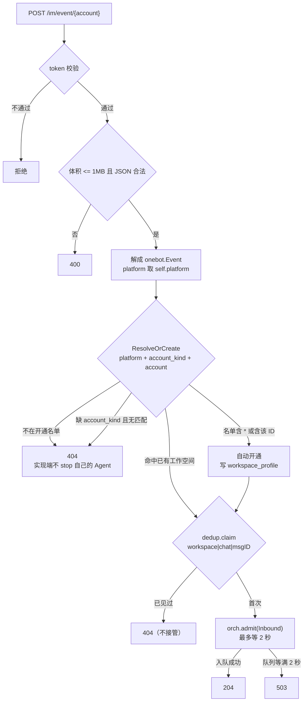

# IM 接入

把 AstrBot 推来的 OneBot 12 事件收下来、解成 `onebot.Event`、判断这条事件属于哪个机器人账号，扔进入站队列就返回。到这里为止，一行业务判断都没有。

## 边界

| 它做 | 它不做 |
| --- | --- |
| 校验共享 token、限制请求体积、解 JSON | 群白名单判定（`policy` 做，`bot` 调） |
| 按路径里的 `{account}` 找到或开通工作空间 | 消息去重（`bot.AcceptEvent` 里按 workspace+msgID 做） |
| 把事件交给 `bot.AcceptEvent` 入前置队列，2 秒内必须返回 | 补成员名、落库、调模型、发回复 |

这条界线是刻意的：HTTP 处理器里同步做大模型调用，AstrBot 那边会超时重推，同一条消息被处理两遍。

## 接口

| 方法 | 路径 | 说明 |
| --- | --- | --- |
| POST | `/im/event/{account}` | 唯一的事件入口 |
| GET | `/im/health` | 探活，给插件自检用 |

请求头：

- `Authorization` —— 和 `im.token` 比对，常数时间比较，避免按响应时间猜 token。
- `X-OneBot-Version: 12` —— 带了别的值直接回 400；不带这个头则放行（老实现不一定发）。
- `X-Impl` —— 实现名，只进日志排障。

`{account}` 受 `[A-Za-z0-9_-]{1,64}` 约束：它会进数据库列和面板 URL。平台名走 OneBot 的标准约束 `[a-z][-a-z0-9]*`，**不允许下划线**——所以 `qq_official` 是账号类型不是平台名，工作空间 ID 里的三段是 `qq` + `official_bot` + `1906072771`。

## 一条事件怎么落到队列

回 404 的含义要说清：**不是错误，是"这个账号我不接管"**。AstrBot 侧据此不 stop 自己的 Agent，交回平台兜底回复，避免两个机器人都装死。

## 状态与字段

| 概念 | 从哪来 | 例子 |
| --- | --- | --- |
| `platform` | 事件 `self.platform` | `qq` |
| `account_kind` | 事件扩展字段 | `official_bot` / `personal_account` / `app` |
| `account` | URL 路径段 | `1906072771`（AppID） |
| 工作空间 ID | `WorkspaceID(platform, kind, account)` | `qq_official_bot_1906072771` |
| 会话键 | `ChatKey(workspaceID, chatID)` | `qq_official_bot_1906072771\|41EA1D28…` |

`self.user_id` 故意不参与归属：QQ 官方的群内 openid 换个群就变，拿它当键会把同一个机器人拆成好几个工作空间。

## 失败怎么办

| 失败 | 行为 | 谁兜底 |
| --- | --- | --- |
| token 不对 | 直接拒，不解析正文 | 实现端 |
| 正文超 1 MB 或 JSON 坏 | 拒 | 实现端 |
| 账号未开通且不在名单 | 404 | 平台自己回 |
| 同一条 `message_id` 重复推 | 认作重复，丢弃 | 无（已处理过） |
| 入站队列满 | 503 | 实现端按自己的策略重推 |
| 进程正在关闭 | 不再接新事件 | 排空存量 |

503 是唯一"该重试"的信号。其他都别重试——重推只会再来一遍同样的判定。

## 相关决策

- 一个账号一个工作空间，共用一份库：[ADR-0001](../adr/0001-single-shared-db.md)
- 白名单、开通名单只有一份实现：[`policy`](../architecture/domains.md)

## 代码位置

| 文件 | 看什么 |
| --- | --- |
| `im/server.go` | 路由、token 校验、体积上限、`EventConsumer` 接口 |
| `bot/ingest.go` | `AcceptEvent`（归属、去重、入队）与 `Run`（消费循环） |
| `workspace/workspace.go` | `ResolveOrCreate`、`WorkspaceID`、账号类型枚举 |
| `policy/policy.go` | `AllowsStream`、`AllowsAllStreams`、开通与只记录名单 |
| `onebot/types.go` | `Event` 的标准字段，`Platform()` / `Kind()` / `ChatID()` |
