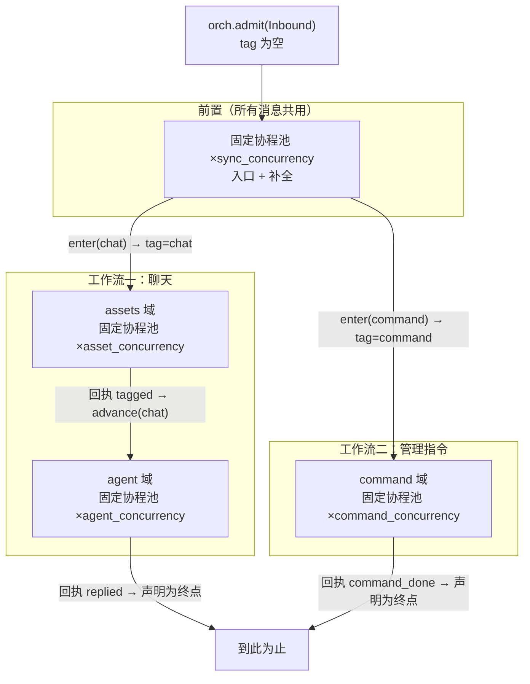
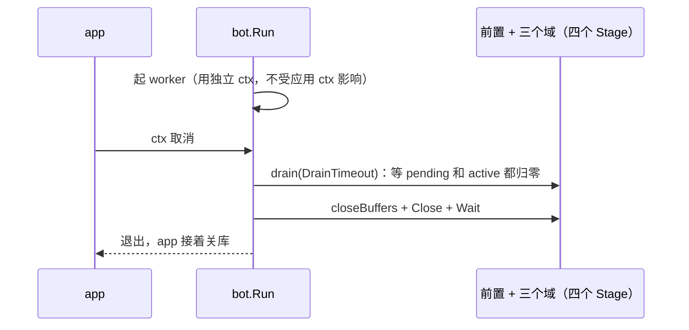

# 域与队列（一个前置 + 两条工作流）

一条消息由编排层放进前置，前置补完名后回一句「走哪条工作流」，然后在那条工作流里由一个域传到下一个域，走到回复或指令执行。节点之间的传送带是内存队列，每个节点自己管批量、并发、重试。

**前置不属于任何一条工作流**：所有消息都要过它（入口 + 补名），但它不做业务。剩下两条工作流互不相连：

- 聊天工作流（数据平面）：打图标签 → 生成回复。
- 指令工作流（控制平面）：管理指令执行完就结束，不占大模型并发槽、不进群聊缓存。

**域不知道下游是谁**。域处理完只交回一组回执（`Topic` + 载荷），由编排层在**所属工作流**的 `next` 里查到下一个域再投；域的代码里搜不到任何 `Buffer`。

**域也不知道自己是不是最后一站**。终止写在工作流上（`orch.exit`），不写在域里。域的返回值里没有「到此结束」这种表达——它只如实说「这一步发生了什么」，收不收、往哪送，是那条工作流的 `next` / `ends` 的事。

## 边界

| 它做 | 它不做 |
| --- | --- |
| 把消息按会话分片、批量派发、失败重试、超限记现场 | 决定消息怎么补名（`workspace.PrepareBatch`） |
| 保证同一个群的消息按到达顺序处理、不同群并行 | 决定回复内容（`speech`） |
| 节点间只传 `pipeline.Item`（JSON 载荷） | 入站 HTTP、发送动作 |

## 四个队列

队列是按「它喂给哪个节点」命名的，不是按「谁造出来」命名。前置与三个域各一条。

| 队列 | 谁放 | 谁取 | 载荷 | 消息的 tag |
| --- | --- | --- | --- | --- |
| `sync`（前置） | `orch.admit`（`bot.AcceptEvent` 调） | `handleSync` | `conversation.Inbound` | 无（还没定） |
| `assets` | 前置回执 `chat` → 聊天工作流入口 | `handleAssets` | `conversation.Synced` | `chat` |
| `agent` | 编排层收到 `TopicTagged` 回执 | `handleAgent` | `conversation.Synced`（多了 `Assets` / `ImageNotes`） | `chat` |
| `command` | 前置回执 `command` → 指令工作流入口 | `handleCommand` | `conversation.Synced`（管理指令，只走这一个域） | `command` |

`Item` 字段：`ID`（`node|tag|key|消息ID`，天然幂等键）、`Key`（分区键，现在是 `workspaceID|chatID`）、`Node`（**要去**的那个节点，接 MQ 时就是 topic）、`Tag`（**所属工作流**，接 MQ 时就是 tag；前置阶段为空）、`Body`（JSON）、`Attempts`。载荷类型定义在 `conversation` 里，`pipeline` 不定义——否则底层包为了用值对象会反过来 import 编排层。

`Node` 与 `Tag` 就是 RocketMQ 的 topic 与 tag：tag 只在所属工作流内唯一，每条工作流可以各有一个 `done`，同一个域也可以被多条工作流复用。

## 前置与三个域各干什么

| 节点 | 入口 | 做什么 | 交回什么 | 失败去哪 |
| --- | --- | --- | --- | --- |
| `sync` 前置：补全 | `handleSync`，再交 `router.route` 择路 | 按工作空间分组 → `PrepareBatch` 补成员名、补被引用消息 → 写 `messages` | 工作流名：`WorkflowCommand`（命中管理指令）或 `WorkflowChat` | 补全会重试 `sync_retries` 次，超限进 alerts；择路不会失败 |
| `assets` 图片标签 | `handleAssets` | 查图库有没有这条图的描述，没有才调视觉模型 → 写 `image_notes`；没打完的写 `asset_tag_jobs` 欠条 | `TopicTagged` | 欠条留给后台补，不阻塞消息 |
| `agent` 生成回复 | `handleAgent` | 进群聊缓存 → 学身份 → 判断该不该回 → 交 `speech` | `TopicReplied`（聊天工作流的终点） | 生成的失败由 `speech` 自己兜 |
| `command` 管理指令 | `handleCommand` | 交 `speech.RunInternalCommand`：再判一次匹配 → 判权限 → 执行 handler | `TopicCommandDone`（指令工作流的终点） | 不重试（`Retries` 固定 0，指令副作用不幂等），失败只记日志 |

**字段的含义**：`Item.Node` 记的是目标节点，不是造出它的节点。前置造出「进聊天工作流」那条 item 时，`Node` 已经是 `assets`，不是 `sync`。幂等键与告警分类（`dead_letter_<node>`）都按它算。

前置的路由用的是只读匹配（`speech.MatchInternalCommand`），它不执行任何东西；真正的执行集中在 `RunInternalCommand`，权限判定只写在它里面。路由与执行各判一次：两次之间路由表可能被别的指令改过（`#删除人格` 会把关键字删掉），第二次失配就丢弃（正文在前置已经入库）。

`record_only_accounts` 里的账号不走指令域：指令消息按普通消息进 `agent`，由那里的既有分支回固定话术。

`agent` 里有两个容易看漏的取舍：

- **只记录不回复的账号**（`record_only_accounts`）到这里就结束：缓存、入库、标签全部照做，只在被点名时回一句固定话术。所以主备切换时备份号的数据一直是热的。
- **主动插话是 latest-wins**：同一批里只看最后一条；如果这个会话自己队列里还有积压（`orch.backlog`），这次干脆不判，等下一批的最后一条。刷屏时不会每条都跑一次裁判。

## 调度方式

每条箭头都由编排层执行：节点把手里的活干完、把「这一步发生了什么」交回去，编排层在**消息自带的那条工作流**里查到下一站，再投进对应队列（同时把 tag 带下去）。域之间没有直接连线，也没有“我到终点了”这种汇报——终点是工作流的属性。

每个域内部都是同一套三层结构：`ready` 队列（队首=最久没处理的会话）+ `inflight` 标记（同一会话只允许一个协程）+ 固定协程池。

要点：

1. **协程不绑定会话**。池里的协程从就绪队列挑一个 key 处理一批，交还后再挑下一个，所以协程数等于 `*_concurrency`，跟有多少个群无关；空闲的群只是队里的一项。
2. **同一个 key 同一时刻只有一个协程持有**（`inflight`），这就是"同一个群的消息按到达顺序处理"的保证；不同 key 并行。
3. **一个协程一次最多连续吃 3 批**同一会话（`maxBurstPerTurn`），吃完让位，防止活跃的群把池子占死。
4. **参数是现读的**（`StageConfig`）。`settings` 表里改了批量/并发/重试，下一批就生效，不用重启。

## 参数

| 参数 | 默认 | 说明 |
| --- | --- | --- |
| `sync_batch` / `sync_linger_ms` | 20 / 20 | 一次取几条、凑批最多等多久 |
| `sync_concurrency` / `sync_retries` | 8 / 3 | 库只开一个连接，并发再高也是排队 |
| `asset_batch` / `asset_concurrency` | 4 / 3 | 实际出站请求还要乘 `tag_concurrency` |
| `agent_batch` / `agent_concurrency` | 1 / 3 | 对齐模型服务的并发槽位（`-np`），别越过它 |
| `command_batch` / `command_concurrency` | 1 / 2 | 管理指令域；没有 `command_retries`，代码里固定 0 |
| `per_chat_capacity` | 500 | 单群积压上限 |
| `global_capacity` | 5000 | 全进程积压上限 |
| `drain_timeout_sec` | 10 | 关停时最多等多久把存量做完 |

队列满时 `Put` **阻塞**（由 ctx 控制），不静默丢。入站那一层最多等 2 秒，等不到就回 AstrBot 503。

## 关停

排空失败只记一条 WARN，不阻塞退出。消息正文在前置阶段就已经同步入库了，最后几条没跑完最多是"没有回复"，不会"消息丢了"。

## 失败怎么办

| 失败 | 现象 | 处理 |
| --- | --- | --- |
| 载荷解码失败 | 这条永远解不开 | 直接进失败列表，不重试 |
| 工作空间已不存在 | 整批跳过 | 记 DEBUG，不报错 |
| 写库失败 | `SaveMessage` 返回 0 | 不阻塞，这条当"没有行号"继续走 |
| 节点处理超过重试上限 | 面板的"异常现场"里出现 | 写 `alerts`，人工看一眼 |
| 关停排空超时 | 日志 `关停排空超时` | 有在途生成没结束，属正常 |

## 相关决策

- 为什么用内存队列把各域串起来：[ADR-0005](../adr/0005-orchestration-layer.md)
- 以后要不要换成 MQ、换之前缺什么：[design/](../design/) 里《上 MQ 之前的账》
- 写库为什么是先 UPDATE 后 INSERT：[ADR-0004](../adr/0004-update-before-insert.md)

## 代码位置

| 文件 | 看什么 |
| --- | --- |
| `pipeline/contracts.go` | `Item`、`NewItem`、`DecodeItem`，节点名常量（`Node*`） |
| `pipeline/buffer.go` | `Buffer`（放/取/确认/关/量）与 `Peeker`（数积压/非阻塞取）为什么拆开、`MemoryBuffer` 的阻塞与关闭语义 |
| `pipeline/worker.go` | `Stage` 的池、ready 队列、inflight、`maxBurstPerTurn`、重试与死信；`BatchHandler` 的批边界契约 |
| `bot/ingest.go` | `Run`（起停、排空）、`AcceptEvent`（归属、去重、入前置） |
| `bot/stages.go` | `handleSync`（补全）/ `handleAssets` / `handleAgent` / `handleCommand` |
| `bot/router.go` | `route` / `workflowOf`：补全之后择路。为什么它是函数不是阶段，文件头写清了 |
| `conversation/types.go` | `Inbound`、`Synced` 的字段与谁填什么 |
