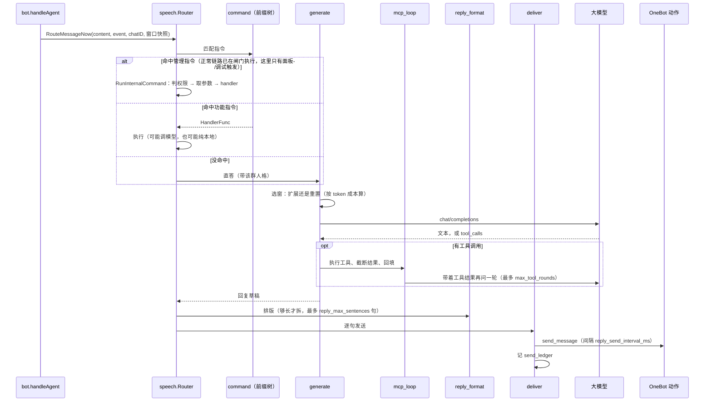

# 发言

一条已经补好名、打好标签的消息，到这里决定三件事：要不要回、回什么、怎么发出去。

## 边界

| 它做 | 它不做 |
| --- | --- |
| 指令匹配、直答、主动插话裁决 | 入队、补成员名、写 `messages`（前置做完了） |
| 选窗、拼上下文、调模型、跑工具轮 | 图片描述（打标签域做完了） |
| 排版、分句、调发送动作、记发送台账 | HTTP 入站校验、工作空间归属 |

依赖只朝下：`speech` 只 import `conversation`、`config`、`llm`、`onebot`、`mcpserver` 这些中低层包，**不 import `bot`、`pipeline`、`web`**。

## 一个工作空间一个 Router

每个 `Router` 服务一个机器人账号，持有自己那份缓存与锚点（`conversation.Store`），共享的只有 LLM 客户端、OneBot 客户端、提示词配置和 MCP 工具。

| 字段 | 作用 | 并发上的处理 |
| --- | --- | --- |
| `table` | 当前指令路由表 | `atomic.Pointer`，热重载时整体替换，分发时无锁读 |
| `internalCommands` | 内置指令（切换人格等） | 启动时注册，之后只读，不从 `table` 里筛 |
| `mcp` | 工具提供者 | 没启用时是 nil |
| `groupPersona` | 各群当前人格 | 读写同一分发路径，加锁防未来并发 |
| `store` | 群聊缓存与选窗锚点 | 由 `workspace` 注入，多账号各一份 |

指令表整体替换而不是就地改，是因为 `rebuild` 可能来自配置监听的 goroutine，而分发和内部指令的异步任务同时在读。

## 包内分工

| 文件 | 干什么 |
| --- | --- |
| `dispatch.go` | 薄入口：一条消息进来，命中指令就分发，没命中就走直答 |
| `command.go` | 指令表：前缀树 + 整表原子替换 |
| `judge.go` | 判定：这条消息冲谁来（`IsAddressed`）、要不要主动接话 |
| `proactive.go` | 主动接话：裁判 + 每群串行 worker + 三重限流 |
| `generate.go` | 生成：选窗 → 拼 user 消息 → 调模型，有工具就进多轮 |
| `mcp_loop.go` | 工具轮：执行调用、截断结果、回填、直到模型给出文本 |
| `reply_format.go` | 排版：把长回复拆成最多 N 句 |
| `deliver.go` | 交付：句子 → 发送动作 → 台账 → 聊天渠道 |
| `persona_render.go` | 人格：按群绑定，渲染成提示片段 |
| `internal_cmd.go` | 内置指令：群内动态增删指令、切人格这类不花模型钱的命令 |
| `agent_gate.go` | 门控指令 `#启动` / `#关闭`：写会话开关（打标签 + 生成一起管），`#启动` 带人格名时顺带绑定 |
| `command_run.go` | 内部指令的“判”与“做”：`MatchInternalCommand`（只读，给闸门用，顺带交回 `ContinueAfterRun`）、`RunInternalCommand`（唯一副作用入口） |

## 管理指令的权限与入口

内部指令（`Category == "internal"`）会改系统状态，默认就不该开放：

- **每个群单独配管理员**（`bot.command_admins`），名单外的成员一律拒绝；没配的群 = 没人能用。管理员身份不跨群继承，`"*"` 不是通配符。
- **两个例外**：`#帮助` 对所有人开放（查看列表无副作用）；私聊直接放行（只有一个人，没必要再压权限）。
- **只判 `internal`**：「锐评」这类功能指令（`chat_review`）不受影响。

权限判定只有一份实现（`policy.CanUseCommand`），调用点只有 `RunInternalCommand`。`MatchInternalCommand` 是只读的、不判权限，它只回答“这条消息要不要在闸门里执行”，并把该指令的 `ContinueAfterRun` 一并交回拓扑。

`#启动` 是唯一 `ContinueAfterRun = true` 的内部指令：它执行完还要让这条消息继续去 `agent`，所以执行完由闸门域把关键字记进 `Synced.CommandRan`，下游看到它就不再把这句话当指令匹配一遍（那会二次执行、而且一句不回），而是走 `ReplyAddressedNow` 按当前人格直答。`#关闭` 则是普通终止型：开关关上、回一句回执就结束。

指令参数按**文本段**解析（`commandText`）：渲染后的正文会把 `@昵称(ID)` 按原位置拼进去，直接拿来切参数会让「`#切换人格` + 末尾还 @ 了机器人」变成「未找到人格：@昵称(ID)」。

## 一次 @ 的处理

## 要不要回

被 @ 或被叫昵称，`IsAddressed` 返回 true，走上面那条路。没被点名的消息交给主动插话，要过三道闸：

| 闸 | 配置 | 作用 |
| --- | --- | --- |
| 冷却 | `proactive_cooldown_sec` | 主动发过一次后，这个群一段时间内不再判 |
| 连发上限 | `proactive_max_streak` | 同一话题最多连续主动几次，到顶就只能等被点名或群静默 |
| 判定间隔 | `proactive_judge_interval_sec` | 从**上次裁判开始**计时；间隔内到达的新消息直接丢，不排队延后 |

再加一道超时：单次判定超过 `proactive_judge_timeout_sec` 一律按"不回"处理。`proactive_judge_images` 控制判定时能不能附图片（0 = 纯图片消息不判）。

三重闸之外，`bot.handleAgent` 还做了一层：只有 `agent` 节点没有积压时才判，且一批只看最后一条。这是为了刷屏时不重复烧裁判的钱。

## 工具轮

模型说要调工具，就真的去调，把结果回填后再问一轮，直到它给出文本。

| 参数 | 默认 | 为什么是这个数 |
| --- | --- | --- |
| `max_tool_rounds` | 5 | 每轮都重发完整上下文；好在第 2 轮起前缀与第 1 轮一致，走缓存命中价 |
| `tool_timeout_sec` | 30 | 单个工具调用超时 |
| `max_tool_result_rune` | 2000 | 防止一次返回几十 KB 把上下文撑爆 |
| `breaker_failures` / `cooldown` | 5 / 60s | 按服务分别计数；"连得上但一调就报错"的服务熔断后立刻失败，模型能快点改口 |

## 排版与发送

- 回复足够长才排版：`reply_rewrite_min_runes`（默认 60）以下直接发原文，省一次模型调用。
- 排版上限 `reply_max_sentences`（默认 5）。
- 分句发送：`reply_send_interval_ms > 0` 才拆，QQ 官方对同一条触发消息的被动回复最多 5 次，超过 5 句的余下部分合并进第 5 条；配 0 就合成一条发。

## 失败怎么办

| 失败 | 行为 |
| --- | --- |
| 模型调用失败或被熔断拦下 | 回一句固定话术，不干等 |
| 工具调用失败 | 结果里带错误文本回填给模型，它自己决定换工具还是改口 |
| 触发消息已滑出窗口 | 放弃这条回复，把现场（首尾消息、窗口大小）记进 alerts |
| 只记录不回复的账号被点名 | 回固定话术（`RecordOnlyReply`），不调模型 |

## 相关决策

- 窗口按 token 成本扩还是重置：[ADR-0006](../adr/0006-token-cost-cache-window.md)

## 代码位置

| 文件 | 看什么 |
| --- | --- |
| `speech/router.go` | `Router` 字段、`table` 的原子替换、包注释里的文件分工 |
| `speech/dispatch.go` | `RouteMessageNow`、`TryProactiveNow`、`SayFixed` |
| `speech/judge.go` | `IsAddressed` 的判定规则 |
| `speech/proactive.go` | 三重限流、每群串行 |
| `speech/generate.go` / `mcp_loop.go` | 选窗、工具轮 |
| `speech/prompt.go` / `prompt_system.yaml` | 提示词与指令定义 |
