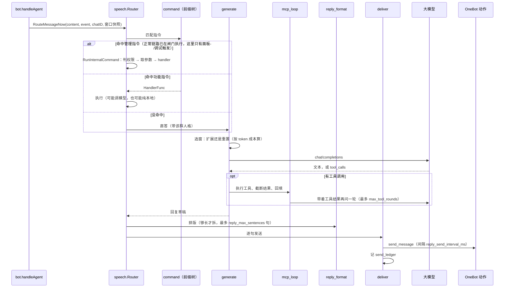

# 发言

一条已经补好名、打好标签的消息，到这里决定三件事：要不要回、回什么、怎么发出去。

## 边界

| 它做 | 它不做 |
| --- | --- |
| 指令匹配、直答、主动插话裁决 | 入队、补成员名、写 `messages`（前置做完了） |
| 选窗、拼上下文、调模型、跑工具轮 | 图片描述（打标签域做完了） |
| 排版、分句、调发送动作、记发送台账 | HTTP 入站校验、工作空间归属 |

依赖只朝下：`speech` 只 import `conversation`、`config`、`llm`、`onebot`、`mcpserver` 这些中低层包，**不 import `bot`、`pipeline`、`web`**。

## 一个工作空间一个 Router

每个 `Router` 服务一个机器人账号，持有自己那份缓存与锚点（`conversation.Store`），共享的只有 LLM 客户端、OneBot 客户端、提示词配置和 MCP 工具。

| 字段 | 作用 | 并发上的处理 |
| --- | --- | --- |
| `table` | 当前指令路由表 | `atomic.Pointer`，热重载时整体替换，分发时无锁读 |
| `internalCommands` | 内置指令（切换人格等） | 启动时注册，之后只读，不从 `table` 里筛 |
| `mcp` | 工具提供者 | 没启用时是 nil |
| `groupPersona` | 各群当前人格 | 读写同一分发路径，加锁防未来并发 |
| `store` | 群聊缓存与选窗锚点 | 由 `workspace` 注入，多账号各一份 |

指令表整体替换而不是就地改，是因为 `rebuild` 可能来自配置监听的 goroutine，而分发和内部指令的异步任务同时在读。

## 包内分工

| 文件 | 干什么 |
| --- | --- |
| `dispatch.go` | 薄入口：一条消息进来，命中指令就分发，没命中就走直答 |
| `command.go` | 指令表：前缀树 + 整表原子替换 |
| `judge.go` | 判定：这条消息冲谁来（`IsAddressed`）、要不要主动接话 |
| `proactive.go` | 主动接话：裁判 + 每群串行 worker + 三重限流 |
| `judge_persona.go` | 判官视角的人格片：只取身份/性格/与群友的关系，拼在判官 system 最前面 |
| `generate.go` | 生成：选窗 → 拼 user 消息 → 调模型，有工具就进多轮 |
| `mcp_loop.go` | 工具轮：执行调用、截断结果、回填、直到模型给出文本 |
| `reply_format.go` | 排版：把长回复拆成最多 N 句 |
| `deliver.go` | 交付：句子 → 发送动作 → 台账 → 聊天渠道 |
| `persona_render.go` | 人格：按群绑定，渲染成提示片段 |
| `internal_cmd.go` | 内置指令：群内动态增删指令、切人格这类不花模型钱的命令 |
| `agent_gate.go` | 门控指令 `#启动` / `#关闭`：写会话开关（打标签 + 生成一起管），`#启动` 带人格名时顺带绑定；`personaBanner` 是人格上线时的那一条回执 |
| `command_run.go` | 内部指令的“判”与“做”：`MatchInternalCommand`（只读，给闸门用，顺带交回 `ContinueAfterRun`）、`RunInternalCommand`（唯一副作用入口） |

## 管理指令的权限与入口

内部指令（`Category == "internal"`）会改系统状态，默认就不该开放：

- **每个群单独配管理员**（`bot.command_admins`），名单外的成员一律拒绝；没配的群 = 没人能用。管理员身份不跨群继承：群 ID 不支持通配符，只有单个群的管理员列表里写 `"*"` 才表示“这个群所有人都能控”。
- **两个例外**：`#帮助` 对所有人开放（查看列表无副作用）；私聊直接放行（只有一个人，没必要再压权限）。
- **只判 `internal`**：「锐评」这类功能指令（`chat_review`）不受影响。

权限判定只有一份实现（`policy.CanUseCommand`），调用点只有 `RunInternalCommand`。`MatchInternalCommand` 是只读的、不判权限，它只回答“这条消息要不要在闸门里执行”，并把该指令的 `ContinueAfterRun` 一并交回拓扑。

`ContinueAfterRun = true` 的有两条：`#启动` 与**切成功**的 `#切换人格`。它们执行完还要让这条消息继续去 `agent`，所以执行完由闸门域把关键字记进 `Synced.CommandRan`，下游看到它就不再把这句话当指令匹配一遍（那会二次执行、而且一句不回），而是走 `ReplyAddressedNow` 按当前人格直答。`#切换人格` 另用 `ContinueWhen(extra)` 把三种没切成的分支（只列可选人格 / 名字不存在 / 关键字没人格）挡在外面——那些分支到此为止，否则群里先看到报错、再收到一句莫名其妙的应答。`#关闭` 是普通终止型：开关关上、回一句回执就结束。

`#启动` 还有第二种写法：人格名在前（`#鲸鱼娘，启动！` / `#HRBP,启动!`）。`#` 后面是任意人格名，前缀树存不了，所以它是 **trie 之前**的一条专用规则（`agent_gate.go` 的 `personaStartRe` + `matchPersonaStart`），命中后复用已注册的 `#启动` 路由——`ContinueAfterRun`、权限、handler 都跟那一份走。正因为两种写法的参数位置不同（一个是洗好的名字、一个是未洗的尾巴），`matchInternal` 直接交回已切好的 `extra`，调用方不再按关键字长度二次切。

人格上线时发的不是一句系统话术，而是 `personaBanner`：一条引线（`bannerRule`）→ 该人格的字符画（`config.Persona.Art`，可选、YAML 里手写）→ 一行「<人格名>正在启动中...」。引线是为了挡 `@`：回执是「引用 + @ + 正文」，客户端把 @ 和正文首行拼在同一行，不垫一行它就会挤进字符画首行。字符画必须**左对齐**（`trimArtIndent` 发前会抹掉每行行首空格）—— QQ 会把行首空白吃掉，靠缩进摆位的图在群里必定散架。`#启动`（带名字或沿用当前人格）与 `#切换人格` 走同一个出口——两边说的都是「这个人格上线了」，分成两套文案迟早漂。会话关着时最后一行改成「已切换（本群关闭中，暂时不会回应，发 #启动 可开启）」：那条路上去 agent 会被开关静默丢掉，不写明原因的话群里只看到一张脸、会以为切失败了。没配字符画的人格只发引线和那一行；一个人格都没设过时主角就是机器人自己，报它的昵称（`<机器人昵称>正在启动中...`）——不再退回「已启动：打标签与自动回复已开启」这类系统话术。`#启动` 带的人格名写错时只说这一句：`❌ 未找到人格「X」，仍由「<当前人格>」回应。`（无人格时说“本群还没设定人格”），开关照开、也不发字符画。字符画按 1~3 行、每行不超 12 字符设计：QQ 不是等宽字体，多行大图在手机上会歪；emoji 只在行尾放一个（宽度不一致，夹在中间会把轮廓推歪）。它只用于展示，不进提示词（`RenderPersona` 不读 `Art`）。

指令参数按**文本段**解析（`commandText`）：渲染后的正文会把 `@昵称(ID)` 按原位置拼进去，直接拿来切参数会让「`#切换人格` + 末尾还 @ 了机器人」变成「未找到人格：@昵称(ID)」。

## 一次 @ 的处理

## system prompt 的拼装顺序

三条链路（关键字命中 / 直答 / 主动接话）共用 `ComposeSystemPrompt`，段序固定：

| # | 段 | 来源 |
| --- | --- | --- |
| 1 | 人格块 | 关键字路由用 `route.Persona`；直答与主动接话用 `groupPersonaBlock`（群人格，没设时是一句“普通问答模式”） |
| 2 | 【工具使用】 | 写死在 `composeSystemPrompt` |
| 3 | 身份行（昵称 / 稳定 ID） | `cfg.BotNickname` + `event.BotID()` |
| 4 | 【聊天记录】字段约定 | 写死 |
| 5 | 【要求】 | `reply_requirement`（主动接话换成 `proactive_requirement`） |
| 6 | 【回复焦点】 | `focus_mention` / `focus_last` / `focus_context`，永远是最后一句 |

人格放最前、焦点放最后：先立角色，再讲怎么干活，最后一句决定这次回应到哪。整段 system 每轮都不变（变的是 user 里的聊天记录），所以段内顺序不影响缓存命中范围——人格不会因为“聊天记录一变”就不命中。

## 要不要回

被 @ 或被叫昵称，`IsAddressed` 返回 true，走上面那条路。没被点名的消息交给主动插话，要过三道闸：

| 闸 | 配置 | 作用 |
| --- | --- | --- |
| 冷却 | `proactive_cooldown_sec` | 主动发过一次后，这个群一段时间内不再判 |
| 连发上限 | `proactive_max_streak` | 同一话题最多连续主动几次，到顶就只能等被点名或群静默 |
| 判定间隔 | `proactive_judge_interval_sec` | 从**上次裁判开始**计时；间隔内到达的新消息直接丢，不排队延后 |

再加一道超时：单次判定超过 `proactive_judge_timeout_sec` 一律按"不回"处理。`proactive_judge_images` 控制判定时能不能附图片（0 = 纯图片消息不判）。

三重闸之外，`bot.handleAgent` 还做了一层：只有 `agent` 节点没有积压时才判，且一批只看最后一条。这是为了刷屏时不重复烧裁判的钱。

### 裁判也看人格，但只看气氛那一层

判官的 system prompt 由五段拼成，顺序就是拼装顺序（`prompt_system.yaml` 的 `internal.proactive_judge_*`）：

| 段 | 内容 | 谁能改它 |
| --- | --- | --- |
| 人格片 | 身份 / 性格特质 / 与群友的关系（`judge_persona.go`） | 群人格；没设人格时整段不出现 |
| `_role` | 职责 + 两层规则的优先关系 | 配置 |
| `_mechanical` | 对象、安全、时序、能力：命中就不回 | 只由配置改，角色改不动 |
| `_vibe` | 该不该凑热闹、值不值得接 | 角色决定尺度（雌小鬼乐意拆台，教师只回应问题） |
| `_output` | focus / long_form 的口径与 JSON 形状 | 配置 |

人格片里**没有** `system_prompt`（人格级输出要求）、共享规则和 `emotion`：前两个会让判官以为自己要写回复并与机械层打架，`emotion` 对"该不该开口"没有稳定影响。也就是说，人格在这里不是"以什么身份说话"，而是"这个角色在乎什么、会把哪种话接下去"。

人格片放在最前面：它按群变化，之后的四段对同一个群永远逐字节一致，于是每个群各自形成一条稳定的缓存前缀。放最后能跨群共享前缀，但那样判官读到的是"规则 → 角色"，角色被推到末尾，基本不起作用。

## 工具轮

模型说要调工具，就真的去调，把结果回填后再问一轮，直到它给出文本。

| 参数 | 默认 | 为什么是这个数 |
| --- | --- | --- |
| `max_tool_rounds` | 5 | 每轮都重发完整上下文；好在第 2 轮起前缀与第 1 轮一致，走缓存命中价 |
| `tool_timeout_sec` | 30 | 单个工具调用超时 |
| `max_tool_result_rune` | 2000 | 防止一次返回几十 KB 把上下文撑爆 |
| `breaker_failures` / `cooldown` | 5 / 60s | 按服务分别计数；"连得上但一调就报错"的服务熔断后立刻失败，模型能快点改口 |

## 排版与发送

- 回复足够长才排版：`reply_rewrite_min_runes`（默认 60）以下直接发原文，省一次模型调用。
- 排版上限 `reply_max_sentences`（默认 5）。
- 分句发送：`reply_send_interval_ms > 0` 才拆，QQ 官方对同一条触发消息的被动回复最多 5 次，超过 5 句的余下部分合并进第 5 条；配 0 就合成一条发。

## 失败怎么办

| 失败 | 行为 |
| --- | --- |
| 模型调用失败或被熔断拦下 | 回一句固定话术，不干等 |
| 工具调用失败 | 结果里带错误文本回填给模型，它自己决定换工具还是改口 |
| 触发消息已滑出窗口 | 放弃这条回复，把现场（首尾消息、窗口大小）记进 alerts |
| 只记录不回复的账号被点名 | 回固定话术（`RecordOnlyReply`），不调模型 |

## 相关决策

- 窗口按 token 成本扩还是重置：[ADR-0006](../adr/0006-token-cost-cache-window.md)

## 代码位置

| 文件 | 看什么 |
| --- | --- |
| `speech/router.go` | `Router` 字段、`table` 的原子替换、包注释里的文件分工 |
| `speech/dispatch.go` | `RouteMessageNow`、`TryProactiveNow`、`SayFixed` |
| `speech/judge.go` | `IsAddressed` 的判定规则 |
| `speech/proactive.go` | 三重限流、每群串行 |
| `speech/generate.go` / `mcp_loop.go` | 选窗、工具轮 |
| `speech/prompt.go` / `prompt_system.yaml` | 提示词与指令定义 |
