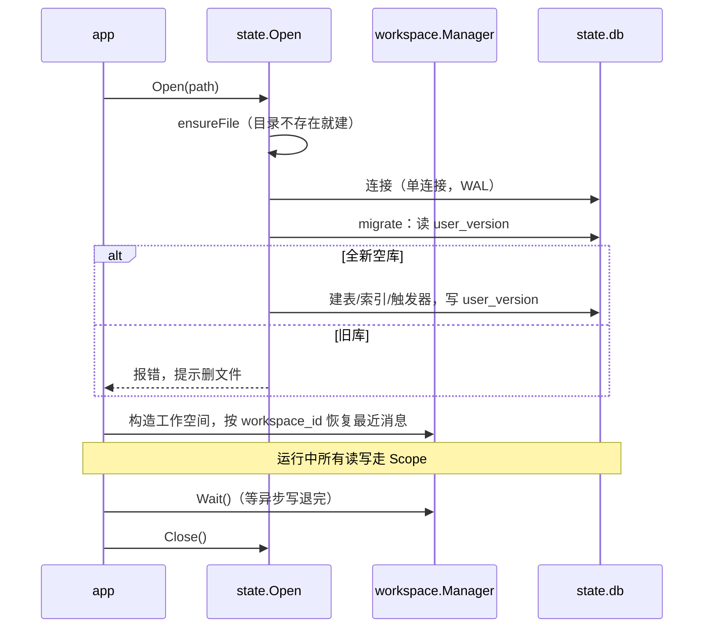

# 存档

所有需要活过重启的东西都在这一个文件里：工作目录下的 `state.db`。没有第二个存储，也没有缓存中间件——内存里那份群聊缓存只是为了少查库，真值都在表里。

## 边界

| 它做 | 它不做 |
| --- | --- |
| 建库、建表、建索引、建触发器 | 决定窗口取多长（策略在 `speech`，锚点存在这） |
| 所有表的读写，全带 `workspace_id` | 业务判定：谁该回、回什么 |
| 启动时恢复最近消息、画像、人格、成员名 | HTTP 和鉴权 |
| 给面板提供群列表、消息、异常现场 | 存配置文件的正文（只存运行时覆盖） |

## 库的形状

12 张表、10 条索引、2 个群统计触发器。

| 表 | 存什么 | 主要写入方 |
| --- | --- | --- |
| `messages` | 所有入站消息，也是给模型看的行号来源 | Stage 1 |
| `anchors` | 选窗锚点：上次发送的窗口起点 | `speech` 生成之后 |
| `members` | 成员显示名、群昵称 | Stage 1 补名 |
| `member_info_history` | 成员资料变更 | 补名时发现不一致 |
| `groups` | 群档案与预计算统计 | 触发器 |
| `group_info_history` | 群资料变更 | 同步群信息时 |
| `workspace_profile` | 每个工作空间的画像（自我 ID、昵称等） | 开通与学身份 |
| `image_notes` | 图片描述图库，按内容哈希索引 | Stage 2 |
| `asset_tag_jobs` | 没打完的图片标签欠条 | Stage 2 / 后台补 |
| `send_ledger` | 发送台账（动作 ID → 结果） | `deliver` |
| `alerts` | 异常现场：窗口太小、重试超限等 | `bot` / `speech` |
| `settings` | 运行时参数覆盖（键为 `pipeline` / `assets`） | 面板改参数 |

## 两条写入规则

**一、先 UPDATE，没命中才 INSERT。**

`messages` 的唯一键是 `(workspace_id, group_id, message_id)`，主键是自增 `id`。用 `INSERT ... ON CONFLICT DO UPDATE` 时，SQLite 在检测冲突**之前**就先分配了 rowid，命中冲突后这个号就白烧了——同一条消息被补名回填、图片回填各写一次，号就跳三次。

所以 `SaveMessage` 是：先 `UPDATE`，`RowsAffected == 0` 才 `INSERT`。这样一次写入最多消耗一个号，且只有真正的新消息才消耗。为什么关心这个号：它就是发给模型看的 `message_id`，跳号会让"第 37 条"这种引用对不上。

**二、只开一个写连接。**

进程内对 `state.db` 只维持一个连接，并发调高只是排队。SQLite 的写锁本来就是库级，多开连接只会多出 `SQLITE_BUSY` 和重试，不会更快。开启 WAL 后读不阻塞写，面板查询不会卡住入库。

群统计的两个触发器同样按这个思路写：先 `UPDATE`，`WHERE NOT EXISTS` 才 `INSERT`，避免给 `groups` 白烧自增号。

## 建库

`state/schema.go` 的 `migrate`：

1. 读 `PRAGMA user_version`，等于当前的 `schemaVersion`（17）就直接返回。
2. 如果版本号大于 0，或者库里已经有 `messages` 表，**报错并要求删文件重来**。
3. 只有全新空库才往下建：12 条 `CREATE TABLE`（带 `AUTOINCREMENT`）、10 条索引、2 个触发器，最后写 `user_version = 17`。

第 2 步那个 `tableExists` 判断不是为了好看：`CREATE TABLE IF NOT EXISTS` 遇到"有表但没有版本号"的野生库会一声不响地跳过，结果是一个缺列却自称最新版的库。宁可报错。

版本号用 SQLite 自带的 `user_version`（文件头 offset 60），不用 `schema_version`（offset 40，那个是 SQLite 自己维护给 prepared statement 用的）。为什么不做升级链见 [ADR-0003](../adr/0003-no-migration-chain.md)。

## 打开与关闭

`Scope` 是按工作空间切出来的库作用域：同一个 `Store`，带上固定的 `workspace_id`。所有方法都不需要调用方再传工作空间 ID，也就不会出现"某个查询漏了过滤条件，把别的账号数据混进来"。

## 失败怎么办

| 失败 | 行为 |
| --- | --- |
| 写消息失败 | `SaveMessage` 返回 0，只记日志；调用方当"这条没有行号"继续走 |
| 写欠条失败 | 记 WARN，图片标签就这次没打上，消息照常回复 |
| 读失败 | 向上返回错误，由调用方决定降级 |
| 库是旧结构 | 启动直接失败，提示删文件（不带病运行） |
| 磁盘满 / 库损坏 | 启动或写入报错；备份后用 `VACUUM INTO` 的副本恢复 |

## 重建

停进程，删掉 `state.db`、`state.db-shm`、`state.db-wal` 三个文件，重启。全新库是空的，工作空间在第一条消息到达时自动开通。

## 代码位置

| 文件 | 看什么 |
| --- | --- |
| `state/schema.go` | 建库门槛、12 张表的 DDL、索引、群统计触发器 |
| `state/state.go` | `Open`、`Store`、`Scope`、`Close`、`Report` |
| `state/messages.go` | `SaveMessage` 的"先 UPDATE 后 INSERT"、`LoadRecent`、`Messages` |
| `state/directory.go` | 成员名、自我 ID、资料历史 |
| `state/persona.go` | 画像与群人格 |
| `state/images.go` / `jobs.go` | 图库与欠条 |
| `state/anchors.go` | 选窗锚点 |
| `state/ops.go` | 发送台账与告警 |
| `state/overview.go` | 面板要的汇总视图 |
