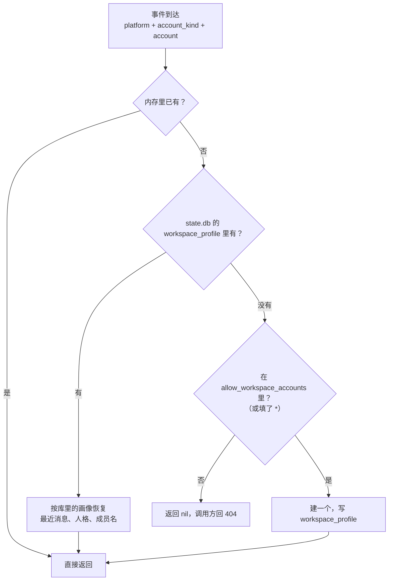
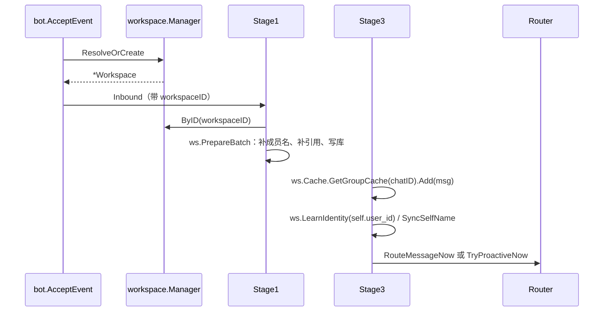

# 工作空间

一个工作空间 = 一个接收账号。它不是一个配置项，而是这个账号的全部运行时状态：群聊缓存、选窗锚点、群人格、成员显示名、它自己的 `Router`、它自己的库作用域。

## 边界

| 它做 | 它不做 |
| --- | --- |
| 按 (平台, 账号类型, 账号) 找到或开通工作空间 | 判断消息该不该回（`policy` + `speech`） |
| 持有每账号的缓存、锚点、人格、成员名 | 拼提示词（提示词全局一份） |
| 从共享库按 `workspace_id` 读写自己的数据 | 管模型连接、MCP 连接（组合根共享） |
| 启动时恢复最近消息，关闭时排空异步写 | HTTP 入口 |

## 身份怎么定

逻辑键是三元组，拼出来的 ID 只是给人看的派生值，代码不反向解析：

| 段 | 来源 | 例 |
| --- | --- | --- |
| `platform` | 事件 `self.platform`，只允许 `[a-z][-a-z0-9]*`，点号换成下划线 | `qq` |
| `account_kind` | 事件扩展字段 | `official_bot` / `personal_account` / `app` |
| `account` | 入站路径段，`[A-Za-z0-9_-]{1,64}` | `1906072771` |

拼起来是 `qq_official_bot_1906072771`。

**`self.user_id` 故意不参与。** QQ 官方的群内 openid 换个群就变，拿它当键会把同一个机器人拆成好几个工作空间。它只用来"学身份"：`LearnIdentity` 记下第一眼看到的自我 ID，之后 `SyncSelfName` 拿它去核对昵称。

昵称核对有 10 分钟的节流（`nameSyncInterval`）：改名不常见，每条消息都问一遍实现端没意义，但又不能永远不失效。

## Manager 上有什么

| 方法 | 干什么 |
| --- | --- |
| `ResolveOrCreate(platform, kind, account)` | 入站唯一入口：命中就返回，允许名单里就开通，否则 nil |
| `ByID` / `Find` / `Default` | 按 ID 找、按平台+账号找、取默认那个 |
| `List` / `Views` / `ViewByID` | 面板用的只读视图（ID、平台、账号、昵称、群数） |
| `GroupName` / `MemberCount` / `NicknameUnique` | 面板展示与起名冲突检查 |
| `Tagger()` / `StateStore()` | 把共享的打标签器与库作用域给阶段用 |
| `ReloadPrompts()` | 配置热重载后重建各 Router 的指令表 |
| `Wait()` | 等所有异步任务退完（关闭时用） |

## 开通与恢复

开通名单只管"第一次"。已经在库里的工作空间重启后直接恢复，不受名单影响——把某个账号从名单里删掉，不会让它已有的数据消失，只是新账号不再自动开通。

## 主流程里的位置

同一个群的处理是串行的（`pipeline` 的 `inflight` 保证），不同工作空间的同一个群 ID 互不影响——所以主备两个号可以在同一个物理群里各自维护一份缓存。

## 主备部署

`record_only_accounts` 里的账号：消息照常入库、打标签、进缓存，只是不 @ 回复、不接私聊、不主动插话，被点名时回一句"我是备用号，不负责回答"。

缓存一直在更新，所以切换时把两个号的配置对调，备份号立刻就有完整的上下文，不需要预热。

## 失败怎么办

| 失败 | 行为 |
| --- | --- |
| 事件缺 `account_kind` 且没有可匹配的已有工作空间 | 拒绝接管（`ErrAccountKindRequired`），回 404 |
| 平台名或账号不合规 | 拒绝，记 WARN |
| 不在开通名单 | 返回 nil，回 404，平台自己兜底 |
| 工作空间已不存在（Stage 里按 ID 找） | 整批跳过，记 DEBUG |
| 关闭时还有异步写没落盘 | `Wait()` 等它们退完，再 `Close()` 关库 |

## 相关决策

- 所有账号共用一份库、按 `workspace_id` 隔离：[ADR-0001](../adr/0001-single-shared-db.md)

## 代码位置

| 文件 | 看什么 |
| --- | --- |
| `workspace/workspace.go` | `Manager`、`Workspace`、`ResolveOrCreate`、`WorkspaceID`、账号类型枚举 |
| `workspace/sync.go` | `PrepareBatch`（Stage 1 的补名与入库） |
| `workspace/mention.go` | 成员名与被引用消息的补全 |
| `workspace/settings.go` | 每工作空间的运行时参数覆盖 |
| `workspace/ledger.go` | 发送台账的读写在什么时机发生 |
| `state/persona.go` | `LoadProfile` / `SaveProfile`（画像落库） |
